# UT3.1 Usabilidad y UX

## Usabilidad

```note
La **usabilidad** es una disciplina que mide el grado en que un producto, sistema o aplicación puede ser utilizado por determinados usuarios para alcanzar sus objetivos de manera efectiva, eficiente y satisfactoria en un contexto de uso específico.
```

Cuando diseñamos aplicaciones multiplataforma, no basta con que funcionen correctamente. También debemos conseguir que los usuarios puedan comprenderlas, aprender a utilizarlas y realizar sus tareas sin dificultades innecesarias.

Una aplicación con una usabilidad deficiente puede provocar errores frecuentes, pérdida de tiempo, frustración e incluso el abandono de su utilización.

La usabilidad se fundamenta principalmente en tres dimensiones:
- Efectividad
- Eficiencia
- Satisfacción


Además, existen otras características relacionadas con la usabilidad, como la facilidad de aprendizaje, la prevención de errores y la facilidad para recordar cómo funciona una aplicación.

> Es importante diferenciar la **usabilidad** de la **accesibilidad**. Mientras que la usabilidad estudia la facilidad con la que los usuarios alcanzan sus objetivos, la accesibilidad busca que las aplicaciones puedan ser utilizadas por personas con diferentes capacidades y necesidades. Ambos conceptos están estrechamente relacionados.


En el diseño de la interfaz de usuario debemos tener en cuenta que los usuarios deben ser capaces de alcanzar sus objetivos con el mínimo de esfuerzo y máximos resultados.

Las características más básicas de usabilidad de cualquier interfaz son fundamentales para crear una experiencia de usuario efectiva y satisfactoria:

-   Útil: que sea capaz de cumplir las tareas específicas para la cual se ha diseñado.
-   Fácil de usar: que sea eficiente, veloz y con la menor cantidad de errores posibles.
-   Fácil de aprender: que no se necesite excesivo tiempo en aprender a trabajar con la aplicación y que sea sencillo recordar su funcionamiento.
-   Elegante en su diseño: para favorecer la percepción del usuario y sus emociones.

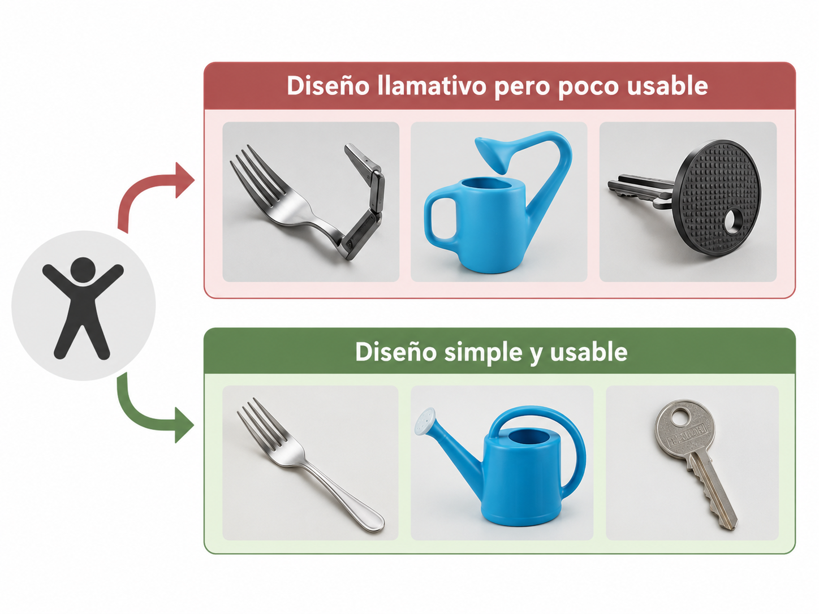

## Principios generales de usabilidad

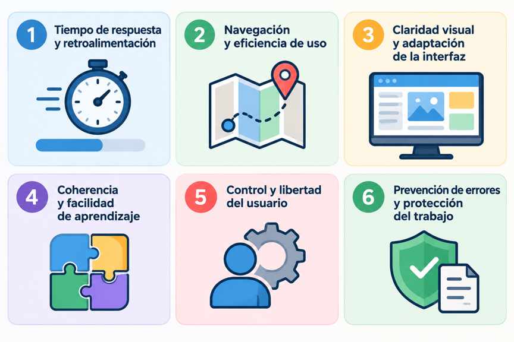

### Tiempo de respuesta y retroalimentación

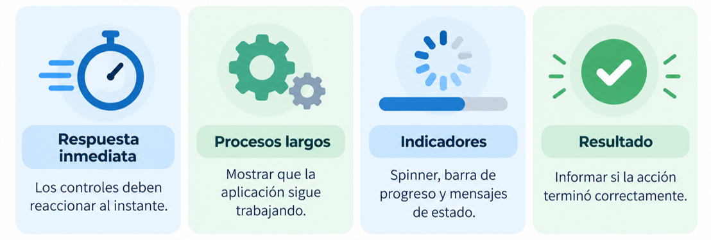

Una interfaz debe responder con **rapidez** a las acciones del usuario y **mantenerlo informado** sobre el estado de la aplicación.

#### Tiempo de respuesta

La aplicación debe responder de manera perceptible a las acciones del usuario, especialmente en operaciones sencillas, como seleccionar una opción de menú o pulsar un botón.

Aunque tradicionalmente se ha utilizado la regla de los dos segundos, no existe un tiempo máximo universal. La respuesta esperada depende del tipo de operación.

Para mejorar el tiempo de respuesta y la interacción se recomienda:

- Proporcionar una respuesta visual inmediata al interactuar con botones, menús y otros controles.
- Evitar animaciones innecesariamente prolongadas que retrasen la realización de las tareas.
- Prevenir operaciones duplicadas cuando el usuario pulse repetidamente un botón mientras se procesa una acción.
- Evitar bloqueos innecesarios de la interfaz durante operaciones prolongadas.

#### Retroalimentación

La retroalimentación (feedback) consiste en informar al usuario sobre el estado de la aplicación y el resultado de sus acciones.

Dependiendo del tipo de operación, podemos utilizar diferentes indicadores:
- **Indicador de actividad (spinner)**: animación que muestra que una operación está en curso, aunque no se conozca cuánto tiempo falta para finalizar.
- **Barra de progreso**: representación visual que indica qué porcentaje de una tarea se ha completado, cuando es posible medir su avance.
- **Mensajes de estado**: textos que informan de la operación que se está realizando, como *Conectando con el servidor* o *Generando informe*.


 

### Navegación y eficiencia de uso

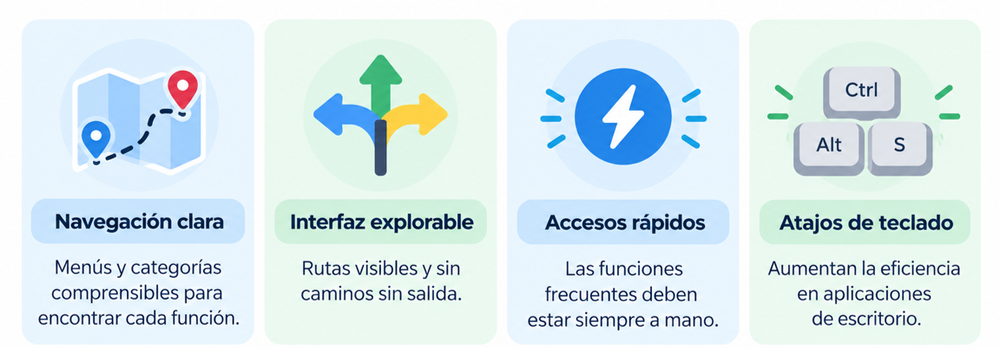

La navegación de una aplicación debe permitir que el usuario encuentre fácilmente las funciones y contenidos que necesita, evitando recorridos confusos o innecesariamente largos.

#### Navegación clara y regla de las tres pulsaciones

La navegación de una aplicación debe permitir que el usuario encuentre fácilmente las funciones y contenidos que necesita para realizar sus tareas.

Tradicionalmente se ha utilizado la denominada **regla de los tres clics**, según la cual el usuario debería poder acceder a cualquier contenido mediante un máximo de tres pulsaciones.

👉 Lo importante no es minimizar siempre el número de clics, sino reducir el esfuerzo necesario para completar una tarea.

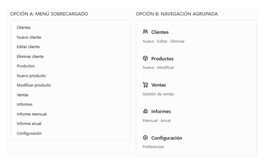

#### Interfaz explorable

La estructura de una aplicación debe estar diseñada de manera que el usuario sepa qué **rutas** existen, y cómo llegar hasta cualquier punto del sistema.

No obstante, esto no implica que se fuerce al usuario a seguir un camino definido, impidiéndole cualquier otra acción. El usuario debe sentir que tiene libertad para navegar por el sistema, y que no va a caer en caminos sin salida.

Junto con la capacidad para investigar el entorno, debe existir una **ruta rápida** para acceder a los contenidos, de manera que tanto el usuario que requiere rapidez como el que quiere explorar el entorno puedan sentirse satisfechos.


#### Atajos de teclado

Los **atajos de teclado** son combinaciones de teclas que permiten ejecutar determinadas acciones de una aplicación sin necesidad de utilizar el ratón.

Son especialmente útiles en aplicaciones de escritorio, ya que pueden mejorar la eficiencia de los usuarios que realizan frecuentemente las mismas operaciones.

Algunos ejemplos habituales en sistemas Windows o Linux son:
- Ctrl + C: copiar el contenido seleccionado.
- Ctrl + V: pegar contenido.
- Ctrl + Z: deshacer la última acción.
- Ctrl + S: guardar un documento o los cambios realizados, cuando la aplicación incorpora esta función.


### Claridad visual y adaptación de la interfaz

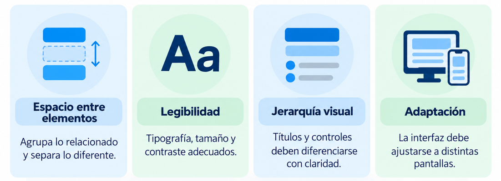

Una interfaz debe presentar la información de forma clara, organizada y legible, evitando que una distribución inadecuada dificulte su utilización.

#### Espacio entre elementos

Tal y como ocurre con toda composición visual, el **espacio** es necesario. Los espacios bien utilizados dan a los usuarios tiempo para pensar y observar el espacio sin estar bombardeados de textos e imágenes.

La confusión visual es muy perjudicial, y los proyectos que están muy cargados son tremendamente molestos. El espacio puede ser de cualquier color de fondo.

 

#### Legibilidad de los textos

Los textos son la base de la mayoría de sitios web y diversas aplicaciones.

Por este motivo, para mejorar la experiencia del usuario debemos prestar mucha atención en la legibilidad de los textos. La selección de la **tipografía** adecuada también es crítica en este aspecto, pero también el tamaño por defecto de la letra, el contraste entre texto y fondo, textos con una longitud adecuada, interlineado, etc. 


#### Diseño adaptable a diferentes pantallas

```note
El **diseño responsive** o adaptativo es una técnica de diseño web que busca la correcta visualización de una misma página en distintos dispositivos.
```

El diseño responsive es prácticamente un requerimiento obligatorio para cualquier sitio web. Este concepto se utiliza especialmente en el desarrollo web, aunque el principio de adaptación también es importante en las aplicaciones de escritorio y móviles.

Gracias al diseño responsive, los usuarios pueden disfrutar de una navegación adecuada según el dispositivo desde el cual accedan. Este tipo de diseño ayuda a navegar con mayor facilidad y a ver cada uno de los elementos a una escala adecuada. 


A la hora de trabajar con interfaces en dispositivos móviles además debemos tener en cuenta la facilidad de acceso a zonas de la pantalla usando nuestras manos.


### Coherencia y facilidad de aprendizaje

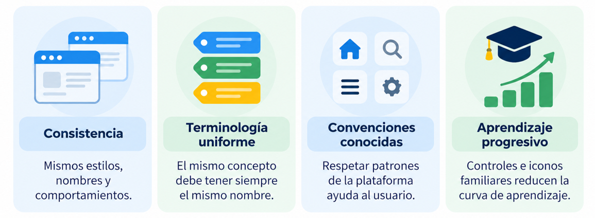

La **coherencia y facilidad de aprendizaje** son fundamentales para que el comportamiento de los elementos de una aplicación resulte constante y predecible.

#### Coherencia y consistencia

La **consistencia** supone la fijación de unas constantes representativas a lo largo de una aplicación, de manera que el mismo tipo de información llegue al usuario siempre de idéntica forma. 


La consistencia también se refiere a la experiencia del usuario. Se facilita el uso de una aplicación cuando se respetan los conceptos de diseño que se han convertido en estándares en el entorno cultural del usuario, usando una **terminología uniforme**.
 
La consistencia debe respetarse también en:

-  **Acciones**: para tareas similares, el usuario debe poder ejecutar la misma secuencia de acciones.
-  **Terminología**: los conceptos utilizados en menús, contenido, ayuda, etc., deben mantenerse a lo largo de toda la aplicación.
-  **Elementos gráficos**: la retícula, la gama de colores, la aplicación de tipografía y otros elementos gráficos deben mantenerse constantes en todo el sistema.

Para lograr esto es recomendable utilizar una **guía de estilo** unificada y estándar para nuestra aplicación.

#### Curva de aprendizaje

La **curva de aprendizaje** representa cómo evoluciona el dominio de una aplicación a medida que el usuario adquiere experiencia utilizándola.

Los usuarios se encuentran más cómodos en aplicaciones o sitios web que resulten fáciles de utilizar y que sigan las guías de estilo proporcionadas por el sistema operativo desde donde se manejan.

Por ejemplo, los iconos de una papelera o una lupa suelen asociarse con las acciones de eliminar y buscar, respectivamente.

#### Modelos de patrones y convenciones

Se pueden consultar los **patrones** de interfaces más comunes en páginas que se dedican a recopilarlos, como [UI Patterns](http://ui-patterns.com/patterns) o en [UI Garage](https://uigarage.net/).


### Control y libertad del usuario

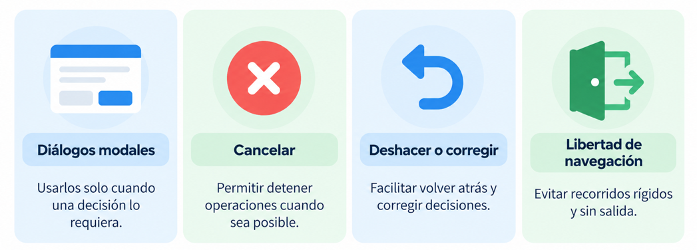

#### Uso adecuado de diálogos modales

Un **diálogo modal** es una ventana que requiere la atención o intervención del usuario antes de permitirle continuar interactuando con el resto de la aplicación.

Los diálogos modales son útiles cuando necesitamos que el usuario tome una decisión importante, confirme una operación o proporcione información necesaria para continuar.


Las ventanas de diálogo modales **suspenden temporalmente** todas las acciones, y obligan al usuario a responder a la cuestión expuesta en la ventana; deberían aparecer solamente en procesos breves. 

Para las **notificaciones** que no requieren una respuesta inmediata, pueden utilizarse mensajes no modales, como avisos dentro de la ventana o notificaciones temporales.

#### Cancelación y recuperación de acciones

El usuario debe disponer de mecanismos que le permitan mantener el control de las operaciones que realiza.

Para ello, se recomienda:
- Permitir cancelar operaciones cuando sea técnicamente posible y seguro.
- Ofrecer la posibilidad de deshacer acciones cuando resulte apropiado.
- Facilitar la corrección de decisiones sin obligar a repetir todo el proceso.

Por ejemplo, si el usuario inicia una importación de datos por equivocación, la aplicación debería permitir cancelarla cuando sea posible sin comprometer la integridad de la información.


### Manejo de errores y protección del trabajo

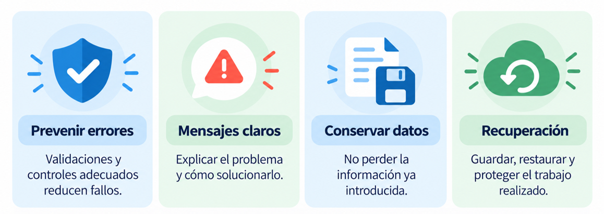

Una plataforma debe estar diseñada de forma que si hay una incidencia al acceder a cualquiera de sus partes muestre un error claro al usuario.


- **Prevenir errores**: utilizar controles adecuados y validar los datos introducidos antes de procesarlos.
- El mensaje **debe describir el problema en términos sencillos** y ser positivo y explicativo. El usuario no tiene por qué conocer la terminología informática, o las causas técnicas por las que el sistema no puede llevar a cabo una acción. Un mensaje genérico ("Error de sintaxis" en lugar de "Falta cerrar el paréntesis") o excesivamente técnico no tiene ninguna utilidad, y es desfavorable.
- Indicar **cómo solucionar el error**: proporcionar información que permita al usuario corregir el problema y continuar con su tarea.
- Las señales auditivas, si se utilizan, deben utilizarse con moderación para no causar alarma excesiva o saturación. 
- Permitir **corregir o deshacer acciones**: facilitar la recuperación ante operaciones incorrectas cuando sea posible.
-   En el caso de **plataformas web**, si se produce una incidencia al acceder a una página, bien porque se haya eliminado o cambiado la *url*, aparezca la redirección correspondiente o el mensaje de error informativo (denominado *error 404* o *página no encontrada*).
En dicha página los usuarios deben poder ver el mensaje de error y volver a inicio o home. Además, esta "página no encontrada" también debe estar diseñada conforme a la estética de la guía de estilo que hayamos utilizado.


#### Protección del trabajo del usuario

La protección del trabajo realizado es un aspecto prioritario de la usabilidad.

Una aplicación debe intentar evitar que los usuarios pierdan información como consecuencia de errores, interrupciones o acciones accidentales.

Por ejemplo: cuando un usuario está finalizando un proceso de compra y está rellenando todos sus datos, si hubiera algún error en el proceso se debería recuperar el carrito de compra y los datos que fueran introducidos previamente.


### Resumen de los principios generales de usabilidad

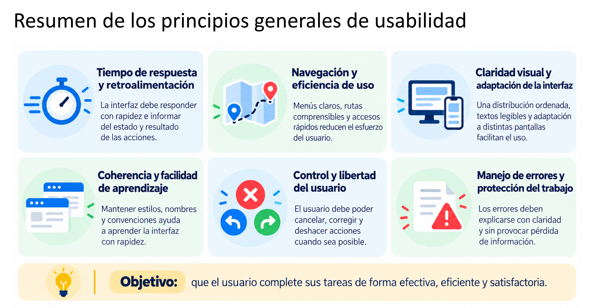

## Métricas de usabilidad

Se definen las medidas o **métricas de usabilidad** como aquellas características de la interfaz que son medibles de forma **objetiva**.

Es decir, dejando a un lado interpretaciones personales, se trata de encontrar una forma que evalúe la usabilidad de manera cualitativa y cuantitativa. Estas características se suelen dividir en tres grupos:

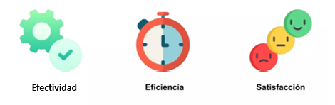

- **Efectividad**:Determina el grado de éxito de una aplicación. Se miden las tareas completadas, accesos a documentación o soporte, funciones aprendidas y errores tolerados.
- **Eficiencia**: Mide los recursos necesarios para completar una tarea en relación con los resultados obtenidos. Habitualmente se evalúa mediante el tiempo empleado o el esfuerzo necesario para el objetivo.
- **Satisfacción**: El nivel de satisfacción de un usuario es clave para la evaluación usable. Se miden la calificación de satisfacción, frecuencia de reutilización, facilidad de aprendizaje y uso voluntario.


-   **Satisfacción**: el nivel de satisfacción de un usuario es clave para la evaluación usable. Las métricas que se contemplan bajo este parámetro son: calificación de satisfacción del usuario sobre la aplicación, frecuencia de reutilización de la aplicación, calificación relativa a la facilidad de aprendizaje o la medida de uso voluntario de la aplicación.
-   **Efectividad**: determina el grado de éxito de una aplicación. Este parámetro está estrechamente ligado también con la facilidad de aprendizaje de la herramienta. Se deben tener en cuenta las siguientes métricas para su evaluación: cantidad de tareas relevantes completadas en cada uno de los intentos, número de accesos a la documentación, al soporte y a la ayuda, cantidad de funciones aprendidas o cantidad y tipos de errores tolerados por los usuarios, entre otras.

-   **Eficiencia**: se define de manera relativa al tiempo que se requiere para completar una determinada tarea con el software implementado.
Las métricas en torno a este atributo se basan en el primero de los intentos: tiempo productivo de uso, tiempo para aprender el funcionamiento de la interfaz o eficiencia relativa al primer intento.


## Evaluación de la usabilidad

La **evaluación de la usabilidad** consiste en analizar una interfaz para determinar si permite a los usuarios realizar sus tareas de manera efectiva, eficiente y satisfactoria.

El objetivo es identificar problemas que puedan dificultar su utilización y proponer mejoras en el diseño.

Existen dos grandes enfoques para evaluar la usabilidad:
-   Las pruebas de expertos
-   Las pruebas con usuarios


> ℹ️ Actualmente, ambos enfoques pueden complementarse con herramientas y  agentes de **inteligencia artificial (IA)** que facilitan la detección de problemas, la automatización de determinadas comprobaciones y el análisis de los resultados.

### Evaluación mediante pruebas de expertos

Consiste en analizar una interfaz utilizando principios, recomendaciones y estándares de usabilidad.

Los evaluadores examinan los elementos de la aplicación para detectar posibles problemas de navegación, consistencia, legibilidad, distribución de controles o gestión de errores.

Tipos de pruebas mediante expertos:

-  **Evaluación heurística**: Verificación frente a heurísticas de diseño.
-  **Revisión de normas**: Se revisa la interfaz para asegurarnos de que cumple con las normas establecidas.
- **Inspección de consistencia**: Se hace a través de una familia de interfaces que conforman la aplicación.
- **Inspección formal de usabilidad**: varios especialistas analizan conjuntamente una interfaz, identificando y valorando problemas relacionados con su diseño, navegación y funcionamiento.

**Uso de inteligencia artificial en la evaluación**

Las herramientas de IA generativa también pueden ayudar a realizar estas evaluaciones mediante:
- **Análisis de capturas de pantalla**: identificar posibles problemas de distribución, legibilidad, consistencia o utilización de controles.
- **Evaluación heurística asistida**: contrastar una interfaz con principios de usabilidad y proponer mejoras.
- **Agentes de IA**: explorar una aplicación y ejecutar determinadas secuencias de interacción para detectar posibles dificultades, cuando disponen de las herramientas necesarias.

Por ejemplo, podemos proporcionar a una IA una captura de pantalla de una aplicación Java Swing y solicitarle que identifique posibles problemas de usabilidad, justificándolos mediante las heurísticas de Nielsen.


### Evaluación mediante pruebas con usuarios

Las pruebas con los usuarios nos van a permitir obtener una valiosa información que será la base para lograr un diseño centrado en el usuario, sobre la que se construirán las etapas del producto final:

**Principales técnicas utilizadas**

- **Pruebas de ejecución de tareas**: se solicita a los participantes que realicen determinadas operaciones mientras se observan sus acciones, errores y dificultades. También pueden medirse el tiempo empleado y las tareas completadas.
- **Reuniones con usuarios**: encuentros realizados durante distintas etapas del desarrollo para conocer necesidades, valorar propuestas y recoger opiniones.  
- **Entrevistas y encuestas:** permiten recopilar información sobre las necesidades, expectativas y satisfacción de los usuarios. Son técnicas complementarias a la observación de tareas.
- **Diseño participativo**: los usuarios intervienen en el proceso de diseño, proponiendo ideas y valorando posibles soluciones mediante reuniones, debates o tormentas de ideas (*brainstorming*).

👉 Una muestra de **5-10 usuarios** es, en la mayoría de los casos, suficiente para detectar muchos problemas de usabilidad, pero los resultados no tienen validez estadística.

La prueba con usuarios permitirá que detectemos cuáles son las tareas que les resultan más difíciles, así como los elementos de la interfaz que son menos comprensibles.

**Uso de inteligencia artificial en las pruebas con usuarios**

La IA puede facilitar diferentes fases del proceso. Sin embargo, los usuarios simulados por IA no sustituyen las pruebas con personas reales, ya que no reproducen de manera fiable todas sus necesidades, comportamientos y experiencias.


### Criterios de evaluación 

Un listado de posibles criterios de evaluación de la **usabilidad** podría ser:

1.	**Navegación clara**: el usuario puede localizar fácilmente las funcionalidades que necesita.
2.	**Organización lógica**: los menús, botones y controles están distribuidos de manera coherente según su función.
3.	**Controles adecuados**: se utiliza el tipo de control más apropiado para cada operación.
4.	**Consistencia visual y funcional**: los elementos similares mantienen un aspecto y comportamiento coherentes.
5.	**Legibilidad**: los textos utilizan tamaños, tipografías y contrastes que facilitan su lectura.
6.	**Distribución equilibrada**: los elementos están correctamente alineados y agrupados, evitando la saturación visual.
7.	**Retroalimentación**: la aplicación informa al usuario de las acciones realizadas y de los procesos en ejecución.
8.	**Prevención y gestión de errores**: se reducen los errores posibles y se muestran mensajes claros para solucionarlos.
9.	**Control del usuario**: se permite cancelar, corregir o deshacer operaciones cuando resulta apropiado.
10.	**Facilidad de aprendizaje**: los controles utilizan convenciones reconocibles y su funcionamiento resulta comprensible.
11.	**Adaptación de la interfaz**: los elementos mantienen su funcionalidad al modificar el tamaño de la ventana o las condiciones de visualización.
12.	**Eficiencia de uso**: el usuario puede realizar sus tareas sin pasos o acciones innecesarias.


## Estándares de usabilidad

```note
La **ISO** (*International Organization for Standardization*) es una organización Internacional de la Normalización que se encarga de la creación de normas y estándares, cuyo objetivo principal es conseguir asegurar que servicios y productos presenten ciertos niveles de calidad, eficiencia y seguridad. 
```

En España se denomina **UNE** y las certificaciones se expiden por la empresa *AENOR*.

Un **estándar** es un documento establecido por consenso y aprobado por una institución reconocida, que prevé, para uso común y repetido, reglas, directrices y características para actividades o sus resultados, encaminada a la consecución del grado óptimo de definición en un contexto dado. Nota: las normas deben basarse en los resultados consolidados de la ciencia, la tecnología y la experiencia, y tener por finalidad promover beneficios óptimos.


Como organismos oficiales de estandarización podemos destacar:

-   En España, el organismo nacional de normalización es **AENOR** (Asociación Española de Normalización y Certificación) que elabora normas técnicas españolas (**UNE**)
-   A nivel europeo está el Comité Europeo de Normalización (**CEN**)
-   A nivel internacional, tal y como hemos visto, la Organización Internacional de Estandarización (**ISO**) compuesta por representantes de los organismos de normalización (ON's) nacionales, que produce normas internacionales industriales y comerciales. Dichas normas se conocen como normas ISO.


Existen diversos estándares **ISO** y normas relacionados directamente con la usabilidad y la accesibilidad, que definen diferentes aspectos relativos a esta.

Se intenta conseguir así una uniformidad en los criterios de diseño, puesto que no sería lógico que cada diseñador de interfaces escogiera unos parámetros distintos.


### ISO 9241-11:2018 — Usabilidad

Esta norma establece los conceptos fundamentales de la usabilidad y proporciona un marco para evaluarla.

Según esta norma, la usabilidad debe analizarse teniendo en cuenta tres dimensiones:
- **Efectividad**: grado en que los usuarios alcanzan correctamente sus objetivos.
- **Eficiencia**: recursos empleados para alcanzar esos objetivos.
- **Satisfacción**: grado en que la experiencia de uso resulta satisfactoria para los usuarios.

Además, destaca la importancia del contexto de uso, formado por los usuarios, sus objetivos, las tareas que realizan y el entorno en el que utilizan la aplicación.


### ISO 9241-210:2019 — Diseño centrado en las personas

Esta norma establece principios y recomendaciones para desarrollar sistemas interactivos teniendo en cuenta las necesidades y características de las personas que los utilizarán.

El diseño centrado en las personas implica comprender sus necesidades, involucrarlas en el proceso de desarrollo y evaluar progresivamente las soluciones propuestas.

Por ejemplo, antes de desarrollar una aplicación de gestión empresarial, resulta conveniente conocer las tareas habituales de sus futuros usuarios y comprobar si la interfaz diseñada facilita su realización.

### ISO/IEC 25010:2023 — Calidad del producto software

Esta norma forma parte de la familia **SQuaRE** (*SQuaRE (System and Software Quality Requirements and Evaluation*), dedicada a los requisitos y la evaluación de la calidad del software.

Establece un modelo de calidad que contempla distintas características de los productos software, como su comportamiento funcional, rendimiento, fiabilidad, seguridad y capacidad de interacción.

Permite analizar la calidad de una aplicación desde una perspectiva más amplia que la usabilidad de su interfaz.

### ISO/IEC 25019:2023 — Calidad en uso

Esta norma también pertenece a la familia **SQuaRE** y define un modelo para evaluar la calidad de un sistema cuando se utiliza en un contexto determinado.

Su finalidad es analizar los resultados y las consecuencias que tiene la utilización del sistema para las personas y las organizaciones.

Por tanto, complementa la evaluación de las características técnicas del producto con el análisis de su utilización real.

## User Experience (UX)

Tal y como hemos visto en la unidad de usabilidad, un buen diseño de interfaz tienda a seguir principios generales o directrices generales para trabajar.

```note
La User Experience (UX) o experiencia de usuario, es el conjunto de percepciones, emociones y respuestas que experimenta una persona antes, durante y después de utilizar un producto, aplicación o servicio.
```

Aunque están estrechamente relacionadas, usabilidad y experiencia de usuario no son exactamente lo mismo:
- **Usabilidad**: se centra en que el usuario pueda completar sus tareas de manera efectiva, eficiente y satisfactoria.
- **Experiencia de usuario**: contempla la experiencia global del usuario, incluyendo sus expectativas, emociones y percepciones.

Los 3 pilares de la experiencia de usuario:


## Leyes del UX

### Ley de Fitts

Basada en el psicólogo Paul Fitts en 1954, que determina ‘El tiempo necesario para alcanzar el objetivo es función de la distancia y tamaño que hay que recorrer hasta él.’ 

Esta ley afecta directamente a la experiencia de usuario a la hora del diseño de botones, por citar un ejemplo, más grandes, especialmente en dispositivos móviles que son táctiles, llegando a la conclusión que con los botones más pequeños es más difícil interactuar.


> Este sería un caso de aplicación de Ley de Fitts, se encuentra cerca de la que se presupone la zona de lectura del ratón (a la derecha, pues somos occidentales y leemos de izquierda a derecha), además abarca un amplio espacio (no es un botón pequeño) por lo que la probabilidad de “acertar” y hacer clic en el botón es alta.

### Ley de Hick

El tiempo que se tarda en adoptar una decisión, aumenta a medida que se incrementa el número de opciones.

Así pues, el tiempo que tarda un usuario en tomar una decisión aumenta cuantas más opciones tiene, es obvio el usuario, intenta contemplar todas las opciones posibles y lo que conllevan y tomará la que considere mejor opción.

Así a la pregunta, qué sería mejor de las siguientes opciones:
1. Un único formulario con 20 opciones hasta completarlo
2. Un formulario por etapas con 4 etapas y 5 opciones por etapa.

> La respuesta aplicando Hick, sería la <u>segunda opción</u>.


### Ley de Jakob

La mejor forma de crear algo nuevo, es buscar referencias, para que los primeros clientes entiendan de que va y puedan asociar.

Los usuarios pasan la mayor parte de su tiempo webs o aplicaciones similares, en caso de que el tuyo no lo conozca. 

Esto significa que prefieren sitios y aplicaciones similares a los que conocen y usan. Por eso es mejor no hacer aplicaciones demasiados originales o creativas.


### Ley de Prägnanz

También llamada “Ley de simplicidad”, que establece que los usuarios perciben las formas complejas de la forma más simple porque es la interpretación que menos esfuerzo mental requiere.
Aquellos diseños que complejizan y se llenan de elementos, serán más difíciles de identificar y eventualmente recordar. Mientras que aquellos diseños más simples, con menos estímulos o donde estos están organizados en una totalidad, estructura o patrón, serán más fáciles de reconocer y recordar. Es más fácil entender y asimilar un cuadrado que un octógono u otra forma compleja. Y requiere de menor intensidad mental para reconocer qué es eso y para qué sirve. 


### Ley de proximidad

Los objetos que están próximos tienden a unirse y en la experiencia de usuario se entienden como el mismo grupo.

El principio sostiene que si estás manejando un grupo de datos, todos los datos que entendamos que corresponden al mismo grupo deben de estar juntos y si empezamos a hablar de datos diferentes deberá de haber un espacio entre ellos. La mente hará el resto y los diferenciará.


> Amazon un ejemplo práctico de esto, pese a la sensación de “caos” a nivel datos, está muy claro donde está cada grupo de estos datos A y B.


### Ley de Miller

Según esta ley las personas pueden recordar hasta 7 elementos distintos en su memoria de trabajo. 

Es por ello que los menús de opciones y navegación en una página web más o menos están basados en este tamaño. Más de 7 elementos genera confusión y perdida de foco del usuario, no es capaz de recordar donde estaba una opción que ahora busca.


### Ley de Parkinson

Por una cuestión cultural, pensamos que como más horas le dediquemos a algo mejor es. Pero la práctica demuestra que no es así.

Cuando sabemos que tenemos más tiempo nuestro cerebro se relaja. En cambio, cuando sentimos la presión de la fecha límite nos centramos en realizar lo importante y que debemos finalizar a tiempo.

¿Qué quiere decir esto a nivel Experiencia de usuario?
Que el usuario tiene establecido ciertas ‘normas’ temporales, dependiendo del tipo de usuario obviamente, pero por poner un ejemplo, realizar una compra en Amazon (una vez has seleccionado la compra obviamente) tiene una duración de 5 minutos (entre rellenar los datos, tarjeta, etc…) Todo lo que sea acortar esos plazos será positivo.


#### Efecto de posición en una serie

Según esta ley, entre los elementos de una serie, los usuarios siempre recordarán mejor el primero y el último.

Esta es la razón por la cual vemos que en la barra de navegación de las aplicaciones se colocan las acciones más importantes a la izquierda o a la derecha, las cuales implementan elementos como inicio o perfil teniendo en cuenta la posición en serie.


#### Ley de Tesler

Larry Tesler establece que para cualquier sistema existe cierta complejidad que no se puede reducir al máximo.

Un ejemplo evidente lo encontraríamos en cualquier web o aplicación para comprar billetes, dentro de la cual ya están comprimidas al máximo sus opciones de búsqueda.


## Usabilidad en interfaces de escritorio

Cuando trabajamos con **interfaces de escritorio** desarrolladas en *Java Swing* o posteriormente en *JavaFX*, los principios de usabilidad siguen siendo los mismos, pero deben concretarse en aspectos visuales y funcionales específicos.

El objetivo es que el usuario pueda comprender, manejar y disfrutar la aplicación sin necesidad de instrucciones adicionales, logrando que cada elemento cumpla su función de forma clara e intuitiva.


### Claridad visual y legibilidad

- Utilizar **fuentes legibles**, preferiblemente Sans Serif (pj. Segoe UI, Roboto, Arial).

- Tamaño mínimo recomendado (dependiendo las características pantalla):
    - 12 pt para texto general. 14–16 pt para etiquetas, menús o títulos.

- Cuidar el **contraste** entre texto y fondo. Evita fondos oscuros con texto oscuro o colores muy saturados.

- Usar márgenes y separados entre contenido.

- Usar un **espaciado adecuado** entre botones, etiquetas y campos de texto. En JavaFX puedes usar padding y spacing en los *HBox* y *VBox*; en Swing, márgenes y EmptyBorder.

- Evitar imponer **colores** o estilos llamativos que distraigan:
    - Usar una paleta neutra y coherente (por ejemplo, tonos grises o azules suaves).

- Ayuda ofrecer la opción de *modo oscuro / claro*

### Ayudas al usuario

Los tooltips (mensajes emergentes) son una buena herramienta para mejorar la experiencia de usuario, especialmente en botones o campos de texto cuyo propósito no sea evidente.


Además, mejor que los tooltips, las aplicaciones pueden proporcionar ayuda contextual mediante **textos explicativos** junto a los campos, mensajes informativos o enlaces a documentación específica.


También podrían utilizarse **asistentes inteligentes** que proporcionen ayuda contextual mediante lenguaje natural.

### Consistencia en la interfaz

En las aplicaciones de escritorio, la consistencia debe reflejarse tanto en la apariencia de los controles como en su comportamiento.


- Mantener una estructura visual coherente: menús, botones, colores y tipografías deben seguir una guía de estilo común.

- Las ventanas y cuadros de diálogo deben tener un **tamaño uniforme** y comportamientos predecibles.

- Colocar los *botones de acción principal* (como Guardar, Aceptar, Enviar) en la misma posición en todas las ventanas —por convención, en la parte inferior derecha.

- Evitar usar diseños absolutos con setBounds(). Es preferible usar **layouts** (BorderLayout, GridBagLayout o VBox/HBox) que se adapten automáticamente al tamaño de ventana.


### Navegación y ley de Fitts

La navegación de una aplicación de escritorio debe permitir que el usuario encuentre las funcionalidades que necesita y pueda desplazarse entre sus diferentes ventanas y secciones de forma clara y eficiente.


- Aplicar la **ley de Fitts**: los elementos más importantes deben ser grandes y accesibles. 

- Botones pequeños o con texto muy corto (p. ej. OK) deben evitarse o reemplazarse por nombres más claros (Aceptar, Guardar cambios).

- **Organizar las funcionalidades**: utilizar menús, barras de herramientas o paneles de navegación para agrupar las operaciones relacionadas.

- Proporcionar una barra de **menú o de navegación** superior o lateral claro: permitir al usuario volver fácilmente **atrás** o al menú principal.


- En formularios o interfaces complejas, utilizar pestañas (JTabbedPane / TabPane) o asistentes por pasos (wizard) en lugar de una única ventana con todos los campos.


### Retroalimentación (feedback) 

La **retroalimentación** consistía en informar al usuario del estado de la aplicación y del resultado de sus acciones.

- Cuando una tarea finaliza, puede mostrarse un mensaje de confirmación, como Los cambios se han guardado correctamente.
- Cuando una acción se ejecuta (por ejemplo, guardar datos o conectarse a una base de datos), hay que informar al usuario del progreso: 
    - Muestra un diálogo de progreso (JProgressBar o ProgressIndicator).
    - Desactivar temporalmente botones mientras el proceso está activo.
- Si se produce un problema o **error**, se ha de mostrar un mensaje claro y sin tecnicismos, indicando cómo solucionarlo si es posible.

### Control errores y validaciones

La validación de datos es fundamental para evitar que una aplicación procese información incorrecta y para facilitar que los usuarios puedan corregir sus errores.

- **Validar siempre** los campos antes de procesarlos (por ejemplo, que un campo numérico no esté vacío).
- Usar indicadores visuales para señalar errores:
    - Bordes rojos
    - Iconos de advertencia  
    - Mensajes junto al campo.
- Evitar mensajes de error genéricos como `Error` o `Datos incorrectos`.


### Ejemplo de buenas prácticas

En un **formulario de registro** de usuario (Swing o JavaFX):

- **Claridad visual**: campos alineados, etiquetas legibles y espacios adecuados.

- **Ayudas al usuario**: tooltips explicativos en controles que puedan generar dudas.

- **Consistencia**: botones, estilos y acciones coherentes con el resto de la aplicación.

- **Navegación**: recorrido lógico entre campos y posibilidad de cancelar o volver.

- **Retroalimentación**: confirmación al guardar e indicador de  progreso si es necesario.

- **Errores y validaciones**: mensajes claros junto a los campos incorrectos, conservando los datos introducidos.

