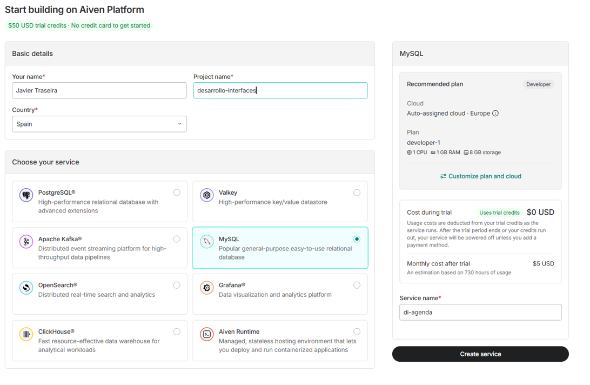
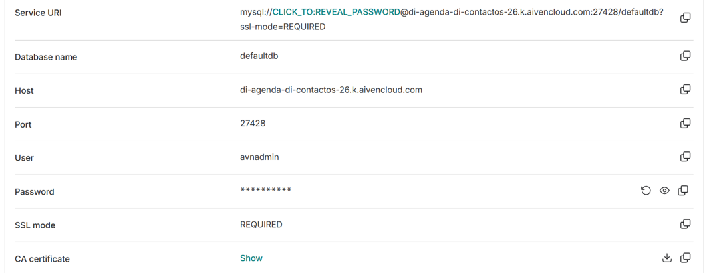
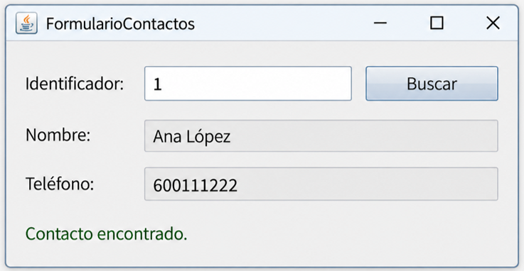

# UT3.2 Conexión de datos a la interfaz

## Introducción

Una aplicación de escritorio suele mostrar datos que deben conservarse después de cerrar la ventana. Por ejemplo, un formulario puede buscar un contacto, mostrar su teléfono o guardar un nuevo registro.

En este repaso utilizaremos **Java Swing** y el editor visual de NetBeans. El objetivo es comprender cómo una acción de la interfaz llega a la **base de datos** y cómo su resultado vuelve a la pantalla. Trabajaremos después con inserciones, tablas y pantallas de acceso.

La base de datos será *MySQL* pudiendo estar alojada en la nube. El programa Java accederá al servidor de forma local o por Internet mediante **JDBC**. 

Veremos los siguientes puntos:

- Incorporar el controlador JDBC al proyecto y configurar una conexión.
- Preparar una base MySQL y conectarse con cifrado y verificación del servidor.
- Ejecutar una consulta con parámetros y recuperar sus resultados.
- Relacionar un evento de un botón con una operación sobre los datos.
- Mostrar el resultado, la ausencia de datos o un error en la interfaz.
- Liberar los recursos y evitar que una consulta bloquee la ventana.

## CRUD

```note
**CRUD** es un término utilizado en sistemas de Bases de datos y programación, referido a sus operaciones principales; **C**reate, **R**ead, **U**pdate y **D**elete.
```


| Operación | SQL habitual | Ejemplo en una interfaz |
|---|---|---|
| Create: crear | `INSERT` | Introducir los datos de un contacto y pulsar Guardar. |
| Read: consultar | `SELECT` | Escribir un identificador y pulsar Buscar. |
| Update: modificar | `UPDATE` | Cambiar el teléfono y pulsar Actualizar. |
| Delete: eliminar | `DELETE` | Seleccionar un contacto y confirmar su eliminación. |


## JDBC

```note
JDBC, Java Database Connectivity, es la API de Java para acceder a fuentes de datos relacionales. Permite abrir conexiones, ejecutar SQL y recuperar resultados mediante un controlador o driver específico del gestor.
```

Con JDBC tenemos una interfaz para conectarnos con una base de datos sin tener que preocuparnos de si es una base de datos MySQl, Derby, Oracle, SQLServer o cualquier otro tipo de base de datos.

El único cambio que habría que hacer para cambiar el tipo de base de datos de una aplicación sería cambiar el **driver** especifico de la base de datos en cuestión.


JDBC ofrece el paquete `java.sql`, en el que existen **clases** e interfaces útiles para trabajar con bases de datos.

| Elemento de `java.sql` | Tipo | Función |
|---|---|---|
| `DriverManager` | Clase | Obtener conexiones utilizando una URL y un controlador disponible. |
| `Connection` | Interfaz | Representar una conexión con la base de datos. |
| `Statement` | Interfaz | Ejecutar SQL sin parámetros de entrada. |
| `PreparedStatement` | Interfaz | Ejecutar SQL con valores asignados mediante parámetros. |
| `CallableStatement` | Interfaz | Invocar procedimientos almacenados. |
| `ResultSet` | Interfaz | Acceder a las filas y columnas de un resultado mediante un cursor. |
| `SQLException` | Clase | Representar errores de acceso a datos. |


### Ciclo JDBC

1. Registrar o asignar driver

2. Configurar la conectividad

3. Establecer conexión con la BD

4. Generar consultas

5. Ejecutar consultas

6. Ejecutar insercciones o modificaciones

7. Cerrar las conexiones


#  


## Preparar el proyecto y la conexión

### Descargar o seleccionar el conector JDBC

El **conector JDBC** permite que Java se comunique con un gestor de base de datos. Se necesita tanto al conectarse a un servidor local como a uno remoto. El conector se elige por el gestor utilizado, no por la ubicación de la base de datos.

| Gestor | Conector y documentación |
|---|---|
| MySQL | [MySQL Connector/J](https://dev.mysql.com/downloads/connector/j/). Será el utilizado en la práctica. |
| MariaDB | [MariaDB Connector/J](https://mariadb.com/docs/connectors/mariadb-connector-j/about-mariadb-connector-j). |
| Derby | [Descargas de Apache Derby](https://db.apache.org/derby/derby_downloads.html). Referencia para proyectos anteriores o ejemplos de comparación. |

En un proyecto Ant se descarga el JAR y se añade a sus bibliotecas. Maven permite declarar la dependencia y descargarla automáticamente.


### Incorporar el controlador al proyecto

Si estamos en **ANT** el primer paso es asignar el driver de la base de datos que vamos a utilizar en nuestro IDE (Netbeans), utilizando el archivo JAR descargado previamente en el apartado librerías de nuestro proyecto o desde la carpeta *Libraries*.


Si trabajamos en un proyecto **Maven** debemos de agregar la dependencia de nuestra Base de Datos en nuestro fichero `pom.xml`:

```xml
    <!-- Dependencia para MySQL -->
  <dependency>
      <groupId>mysql</groupId>
      <artifactId>mysql-connector-j</artifactId>
      <version>9.1.0</version>
  </dependency>
    
    <!-- Dependencia para el cliente Derby (modo red) -->
    <dependency>
        <groupId>org.apache.derby</groupId>
        <artifactId>derbyclient</artifactId>
        <version>10.15.2.0</version>
    </dependency>    
```

### Registrar controlador y configurar conexión en NetBeans

NetBeans permite consultar la base de datos desde el propio IDE:

1. Abre **Ventana → Servicios / Window → Services**.
2. En **Bases de datos / Databases → Drivers**, comprueba si aparece el controlador necesario.
3. Si falta, selecciona **Nuevo controlador / New Driver** y localiza su JAR. Para MySQL Connector/J la clase es `com.mysql.cj.jdbc.Driver`.
4. En **Bases de datos / Databases**, selecciona **Nueva conexión / New Connection** y elige el controlador.
5. Introduce la URL, el usuario y la contraseña del servidor.
6. Prueba la conexión y comprueba que puedes consultar la base de datos prevista. Los nombres de las opciones pueden variar según la versión y el idioma.


### Establecer conexión local desde Java

El siguiente paso es establecer una conexión con la base de datos. 

Hay dos opciones para establecer una conexión:

-  Crear una nueva conexión con la base de datos.
-  Obtener la conexión de un pool de conexiones ya creado previamente. Se trata de una opción más eficiente ya que no hace falta estar abriendo y cerrando conexiones continuamente.

Un ejemplo de establecimiento de una nueva conexión con una BD (derby), usando el método `DriverManager.getConnection(url, usuario, clave)` que devuelve un objeto `Connection`

```java
Connection conexion = DriverManager.getConnection ("jdbc:derby://localhost:3306/cuentas","usuario","password");
```

La cadena de conexión anterior esta compuesta de los siguientes elementos:

     jdbc:protocol://host:port/database,username,password

En donde:

| Elemento | Significado |
|---|---|
| `jdbc:subprotocolo` | Identifica el tipo de conexión que admite el controlador, como `jdbc:mysql:`. |
| `host` | Nombre de equipo o dirección del servidor. `localhost` se refiere al equipo donde se ejecuta Java. |
| `puerto` | Puerto de escucha configurado para el servicio. |
| `base_de_datos` | Nombre de la base a la que se quiere acceder. |
| `username` y `password` | Credenciales que, en estos ejemplos, se pasan como argumentos separados de la URL. |

## Conexiones en la nube

Los programas pueden conectarse con bases de datos en la nube. El programa Java seguirá ejecutándose en el equipo local. El servidor MySQL se encontrará en la nube, por lo que se utilizarán su host, puerto y se configurará TLS.

Los apartados anteriores explican la base común: conector, dependencia del proyecto, conexión del IDE y apertura de una conexión Java.  

Existen 3 proveedores de BBDD relacionales en la nube interesantes:

| Servicio | Base de datos | Plan gratuito | 
|---|---|---|---|
| **Aiven** | MySQL | Sin tarjeta ni plazo de caducidad; 1 GB de almacenamiento y 1 GB de RAM. Puede apagarse por inactividad. | 
| **Neon** | PostgreSQL | Sin tarjeta; 1 GB por proyecto y 100 CU-h de cómputo mensuales por proyecto. Se suspende tras 5 minutos sin actividad. | 
| **Supabase** | PostgreSQL | 500 MB por proyecto y hasta dos proyectos activos; pausa por inactividad. | 

### Crear servicio MySQL en Aiven

**Aiven** aloja y administra el servidor de base de datos. El plan gratuito de MySQL no exige tarjeta ni tiene un plazo de caducidad establecido. Incluye 1 GB de almacenamiento y puede apagarse por inactividad.  

**Creación del servicio**

1. Accede a la [consola de Aiven](https://console.aiven.io/) y crea o accede con una cuenta.
2. Asígnate un nombre del proyecto, como `di-contactos-zayas` y selecciona **MySQL**.
3. Elige el nivel o plan **Free** y revisa que el coste indicado sea gratuito.  
4. Asigna un nombre al servicio, por ejemplo, `di-practica` y pulsa en crear servicio.



**Creación de la base de datos y datos de conexión**

1. Entra en **Connect → Databases → Create database** y crea tu *bbdd*.
2. Introduce el nombre y pulsa en **Add database**.

Finalmente, localiza en *Overview / Connection information* los **datos de conexión**, como la dirección del servidor MySQL, el puerto, el usuario y la contraseña.



### Crear la conexión en NetBeans

Ahora abre **NetBeans**:
- Ve a Ventana → **Servicios** (Ctrl + 5).
- Despliega Bases de datos (*Databases*).
- Haz clic derecho sobre *Databases → New Connection*.
- Selecciona el controlador *MySQL Connector/J Driver*.
> Si no aparece, tendremos que descargar el JAR del controlador (platform independent)

Si NetBeans solicita una URL usa: `jdbc:mysql://HOST:PUERTO/agenda?sslMode=REQUIRED`

| Campo | Valor |
|---|---|
| Host | Dirección host de Aiven |
| Port | Puerto usado por Aiven |
| Database | `agenda` |
| User Name | avnadmin (por defecto) |
| Password | Contraseña generada |

Finalmente, pulsa **Test Connection** para verificar la conectividad.

### Agregar una tabla o datos

Haz clic derecho sobre la conexión y selecciona Execute Command para pegar el siguiente código:

```SQL
USE test;

CREATE TABLE prueba (
    id INT PRIMARY KEY AUTO_INCREMENT,
    nombre VARCHAR(80) NOT NULL,
    apellidos VARCHAR(20) NULL
);

INSERT INTO prueba (nombre, telefono) VALUES
    ('Maria', 'Zayas'),
    ('Albert', "Sotomayor");
```

## Preparar y ejecutar sentencias SQL

### Consultas Statement

El tipo de consulta más sencillo. Para obtener datos almacenados en la BD podemos realizar una consulta SQL (*query*). Podemos ejecutar la consulta usando el objeto **Statement.**

La clase **Statement** dispone de un método llamado `executeUpdate` el cual recibe como parámetro la cadena de caracteres que contiene la sentencia SQL a ejecutar.

Este método únicamente permite realizar sentencias de actualización de la BD: creación de tablas (*CREATE*), inserción (*INSERT*) y borrado de datos (*DELETE*).

```java
// Creación del Statement para poder hacer consultas
Statement st = conexion.createStatement();

// La consulta es un String con código SQL String sqlselect = "SELECT * FROM cuentas";
String sqlselect = "SELECT * FROM cuentas";
```

### Consultas PreparedStatement

Otro tipo de consultas son las **PreparedStatement.** Son consultas más eficientes y facilitan la tarea de escribir las consultas SQL ya que en lugar de tener que estar concatenando las distintas variables con el código SQL, lo que se hace es sustituir en este las variables por **?** y posteriormente se introducen los datos concretos mediante *setters*.

```java
// Creación del PreparedStatement
PreparedStatement pstBuscarCodigo;

// Cadena de asignación y asignación de setters
String sqlBusqueda = "SELECT codigo FROM cuentas WHERE codigo=?"; 
pstBuscarCodigo = conexion.prepareStatement(sqlBusqueda); 
pstBuscarCodigo.setString(1, codigo);
ResultSet rs = pstBuscarCodigo.executeQuery();
```

### ExecuteQuery

Para los dos ejemplos anteriores, que son consultas, veremos como se incluye el código de la ejecución de la consulta mediante el método `executeQuery`.

La consulta del SQL nos devolverá en un objeto **ResultSet**, que tendrá una serie de campos y un conjunto de registros que se pueden recorrer con `next`:

```java
Statement st = cn.createStatement(); 
String sql1 = "SELECT * FROM cuentas";

// Ejecuta una consulta que devuelve resultados
ResultSet rs = st.executeQuery(sql1); 
while (rs.next()) {
System.out.println (rs.getString ("propietario") + " " + rs.getInt(saldo));
}

PreparedStatement pstBuscarCodigo;
String sqlBusqueda = "SELECT codigo FROM cuentas WHERE codigo=?";

pstBuscarCodigo = cn.prepareStatement(sqlBusqueda); 
pstBuscarCodigo.setString(1, codigo);
ResultSet rs = pstBuscarCodigo.executeQuery();
```

### ResulSet

Cuando un campo de un registro de una tabla no tiene asignado ningún valor, la consulta de ese valor devuelve *NULL*. Esta situación puede dar problemas al intentar manejar ese dato. La clase **ResultSet** dispone de un método *wasNull* que llamado después de acceder a un registro nos dice si el valor devuelto fue NULL.

Esto no sucederá así para los datos numéricos, ya que devuelve el valor 0.

```java
String sexo; 
while(result.next())
{
exp = result.getInt("exp"); 
System.out.print(exp + "\t");
nombre = result.getString("nombre"); 
if (result.wasNull()) {
  System.out.print("Sin nombre asignado");
else
  System.out.print(nombre.trim()); 
sexo = result.getString("sexo"); 
System.out.println("\t" + sexo);
}
```

### executeUpdate

Tanto *INSERT*, como *UPDATE* o *DELETE* realizan modificaciones en la base de datos, con lo que deben llamarse utilizando el método `executeUpdate()`. Este método devolverá el número de filas afectadas (número de filas borradas, modificadas o insertadas).

Un ejemplo con los tres tipos:

```java
Statement sentencia = conexion.createStatement();

int filasInsertadas = sentencia.executeUpdate(
   "INSERT INTO contacto (nombre, apellidos, telefono) VALUES " +
   ('Javier','Gomez','111' )");
int filasModificadas = sentencia.executeUpdate("UPDATE contacto SET telefono='111' WHERE id=3");

int filasBorradas = sentencia.executeUpdate("DELETE FROM contacto WHERE id=4");
```

### Cerrar la conexión

Después de hacer las operaciones en la BD que se necesite se deberá **cerrar** la conexión para liberar los recursos. Para ello se utiliza el método close(). Se pueden cerrar también el *Resulset* y el *Statement* de forma manual, pero cerrando la conexión se cierran los otros dos porque están creados a partir de la conexión. Del mismo modo al cerrar el *Statement* también se liberan los recursos del *Resulset*.

    rs.close(); // Cierra el Resulset
    st.close(); // Cierra el Statement
    cn.close(); // Cierra la conexión


> Desde Java 7, JDBC tiene la capacidad de utilizar la instrucción **try-with-resources** para cerrar automáticamente los recursos de tipo *Connection*, *ResultSet* y *Statement*.


## Ejemplo de búsqueda desde un formulario

### Datos de prueba y conexión

Para trabajar con el ejemplo ejecutaremos este script en una base de datos de prácticas MySQL llamada *agenda*, previamente creada por nosotros en **Aiven**. El usuario de la aplicación necesitará permiso de lectura y, para la práctica posterior, de inserción.


```sql
USE agenda;

CREATE TABLE contacto (
    id INT PRIMARY KEY AUTO_INCREMENT,
    nombre VARCHAR(80) NOT NULL,
    telefono VARCHAR(20) NULL
);

INSERT INTO contacto (nombre, telefono) VALUES
    ('Ana López', '600111222'),
    ('Luis Martín', NULL);
```

**Contacto.java**
 Establece la conexión JDBC con la base de datos MySQL en Aiven.

```java
import java.sql.Connection;
import java.sql.DriverManager;
import java.sql.SQLException;

public final class ConexionBD {

    private static final String URL =
            "jdbc:mysql://HOST_AIVEN:PUERTO/agenda?sslMode=REQUIRED";

    private static final String USUARIO = "avnadmin";
    private static final String PASSWORD = "TU_PASSWORD";

    private ConexionBD() {
    }

    public static Connection abrir() throws SQLException {
        return DriverManager.getConnection(URL, USUARIO, PASSWORD);
    }
}
```


### Separar los datos y la ventana

Usaremos una organización pequeña, organizada en paquetes (Vista y Modelo al menos)

| Clase | Responsabilidad |
|---|---|
| `ConexionBD` | Abrir conexiones. |
| `Contacto` | Transportar los datos de un contacto. |
| `ContactoDAO` | Ejecutar SQL y transformar resultados en objetos. |
| `VentanaContactos` | Leer campos, responder a eventos y presentar resultados. |


> **DAO** significa *Data Access Object*, objeto de acceso a datos. Esta separación permite reutilizar las consultas cuando más adelante cambiemos el formulario o incorporemos una tabla.


**`Contacto.java`**:
Se trata de la clase que representa los datos de nuestro contacto, mediante sus atributos y métodos.


```java
public final class Contacto {
    private final int id;
    private final String nombre;
    private final String telefono;

    public Contacto(int id, String nombre, String telefono) {
        this.id = id;
        this.nombre = nombre;
        this.telefono = telefono;
    }

    public int getId() { return id; }
    public String getNombre() { return nombre; }
    public String getTelefono() { return telefono; }
}
```

**`ContactoDAO.java`**:
Se trata de la clase que conoce la base de datos. Realiza las consultas SQL y convierte los resultados en objetos `Contacto`.


```java
import java.sql.Connection; 
import java.sql.PreparedStatement; 
import java.sql.ResultSet; 
import java.util.Optional;

public class ContactoDAO {
    public Contacto buscarPorId(int id) throws SQLException {

    String sql = "SELECT id, nombre, telefono FROM contacto WHERE id = ?";

    try (Connection conexion = ConexionBD.abrir();
             PreparedStatement sentencia = conexion.prepareStatement(sql)) {

            sentencia.setInt(1, id);
            ResultSet resultado = sentencia.executeQuery();

            if (resultado.next()) {

             Contacto contacto = new Contacto(resultado.getInt("id"),resultado.getString("nombre"),resultado.getString("telefono"));
                return contacto;
            }
            return null;
        }
    }
}

```

### Diseñar el formulario en NetBeans

Creamos un **JFrame Form** llamado `VentanaContactos` y añadimos estos componentes con sus etiquetas visibles:

| Componente | Nombre de variable | Configuración o finalidad |
|---|---|---|
| `JTextField` | `txt_id` | Introducir el identificador que se desea buscar. |
| `JButton` | `b_buscar` | Texto visible: Buscar. |
| `JTextField` | `txt_Nombre` | Mostrar el nombre, `editable = false`. |
| `JTextField` | `txt_Telefono` | Mostrar el teléfono, `editable = false`. |
| `JLabel` | `l_estado` | Mostrar el estado de la operación, inicialmente vacío. |

Se asocia el evento `actionPerformed` de Buscar mediante el editor visual. Escribe la lógica en el manejador y los métodos auxiliares fuera del bloque generado `initComponents()`. NetBeans gestiona ese bloque al modificar el diseño.





### Evitar que la ventana se bloquee (opcional)

Tal y como comentamos, swing procesa los eventos y actualiza sus componentes en el **EDT**, hilo de despacho de eventos. Una conexión o consulta puede tardar, por lo que ejecutarla directamente en el manejador puede dejar la ventana sin responder.

Se utilizarán `SwingWorker`: `doInBackground()` hará la consulta y `done()` presentará el resultado en el EDT. Leeremos los campos antes de iniciar la tarea. Los cambios en los componentes se realizarán en el EDT.

Para ello es necesario agregar estos imports en `FormularioContactos.java`:

```java
import java.util.Optional;
import java.util.concurrent.ExecutionException;
import java.util.logging.Level;
import java.util.logging.Logger;
import javax.swing.SwingWorker;
```

Dentro de la clase del formulario, añade este atributo y el siguiente manejador. Si NetBeans ya ha creado `btnBuscarActionPerformed`, sustituye únicamente su contenido, sin duplicar el método.

```java
private static final Logger LOG =
    Logger.getLogger(FormularioContactos.class.getName());

private void btnBuscarActionPerformed(java.awt.event.ActionEvent evt) {
    final int id;
    try {
        id = Integer.parseInt(txtId.getText().trim());
        if (id <= 0) {
            throw new NumberFormatException();
        }
    } catch (NumberFormatException ex) {
        txtNombre.setText("");
        txtTelefono.setText("");
        lblEstado.setText("Introduce un identificador entero positivo.");
        txtId.requestFocusInWindow();
        return;
    }

    btnBuscar.setEnabled(false);
    txtId.setEnabled(false);
    txtNombre.setText("");
    txtTelefono.setText("");
    lblEstado.setText("Buscando contacto...");

    new SwingWorker<Optional<Contacto>, Void>() {
        @Override
        protected Optional<Contacto> doInBackground() throws Exception {
            return new ContactoDAO().buscarPorId(id);
        }

        @Override
        protected void done() {
            try {
                Optional<Contacto> resultado = get();
                if (resultado.isPresent()) {
                    Contacto contacto = resultado.get();
                    txtNombre.setText(contacto.getNombre());
                    txtTelefono.setText(contacto.getTelefono() == null
                        ? "" : contacto.getTelefono());
                    lblEstado.setText("Contacto encontrado.");
                } else {
                    lblEstado.setText("No existe un contacto con ese identificador.");
                }
            } catch (InterruptedException ex) {
                Thread.currentThread().interrupt();
                lblEstado.setText("La búsqueda se ha interrumpido.");
            } catch (ExecutionException ex) {
                LOG.log(Level.SEVERE, "Error al buscar un contacto", ex.getCause());
                lblEstado.setText("No se pudo completar la búsqueda. "
                    + "Comprueba la conexión y vuelve a intentarlo.");
            } finally {
                btnBuscar.setEnabled(true);
                txtId.setEnabled(true);
            }
        }
    }.execute();
}
```

## Excepciones SQL y registros de error

A la hora de trabajar con cualquier programa que acceda a una base de datos con Java JDBC se hace obligatorio controlar las excepciones SQL, las **SQLException**.

**SQLException** es la excepción que se lanza cuando hay algún problema entre la base de datos y el programa Java JDBC.

Por ejemplo, cuando realizamos una consulta debemos de poner nuestro código que maneje el **ResultSet** dentro de un bucle **try-catch.**

```java
try {	   
  stmt = con.prepareStatement("SELECT pais FROM paises");
  rs = stmt.executeQuery();
	   
  while (rs.next())
    System.out.println (rs.getString("pais"));
	   
} catch (SQLException sqle) { }
```


Una vez lanzada la **SQLException** podremos, utilizando los métodos apropiados, extraer de ella información de la excepción que se ha producido:

-  getMessage(), nos indica la descripción del mensaje de error.
-  getErrorCode(), es un código de error que lanza la base de datos. En este caso el código de error es diferente dependiendo del proveedor de base de datos que estemos utilizando.
-  getCause(), nos devuelve una lista de objetos que han provocado el error.
-  getNextException(), devuelve la cadena de excepciones que se ha producido. De tal manera que podemos navegar sobre ella para ver en detalle de esas excepciones.

### Logs de consola

La manera básica de mostrar datos por consola es mediante el método `System.out.println()`. 

No obstante, a la hora de trabajar con nuestros programas lo adecuado será utilizar objeto Logger. El patrón a seguir en este caso es:

```java
Logger.getLogger(NombreDeLaClaseQueLlamaAlLog).log(Nivel, Mensaje);
```

Necesitaremos saber el nombre de la clase que llama al Log, el mensaje que queremos transmitir y el nivel de mensaje de entre estos tipos normalmente:
- INFO: Muestra mensajes informativos
- CONFIG: Muestra mensajes de configuración
- WARNING: Muestra mensajes de alerta
- SEVERE: Muestra mensajes críticos
- FINE: Muestra mensajes de depuración nivel