# UT3.3 Guías de estilo y sistemas de diseño

## Guías de estilo y sistemas de diseño

```note
Una **guía de estilo** es un documento que establece las normas visuales que deben seguirse al diseñar y desarrollar las interfaces de una aplicación o sitio web.
```

Su principal objetivo es garantizar una **apariencia coherente, consistente y uniforme** en todas las pantallas, facilitando el trabajo de diseñadores y desarrolladores.

Además, permite mantener la consistencia visual cuando se realizan modificaciones o se incorporan nuevas funcionalidades a la aplicación.

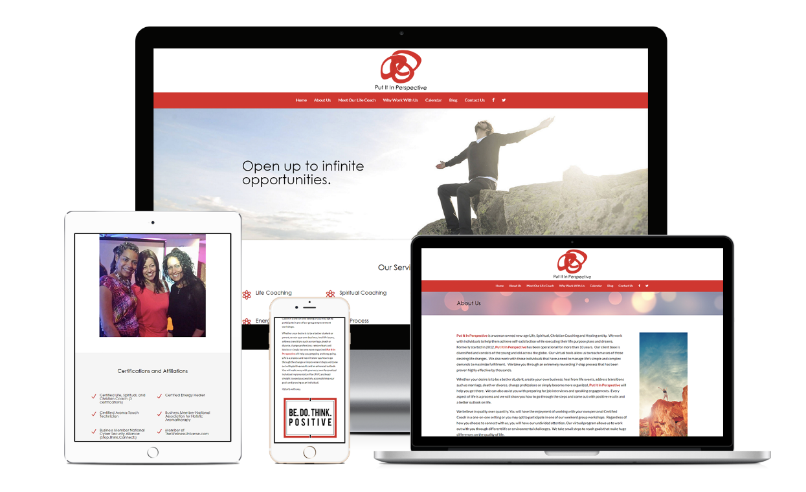

Una guía de estilo establece las reglas visuales que deben aplicarse de forma consistente en una aplicación:

- **Colores:** paleta y usos de cada color.
- **Tipografía:** familias, tamaños y estilos de texto.
- **Distribución:** retículas, alineaciones, márgenes y espaciados.
- **Iconografía e imágenes:** recursos gráficos y criterios de utilización.
- **Componentes visuales:** apariencia de botones, campos de texto, menús y otros controles.

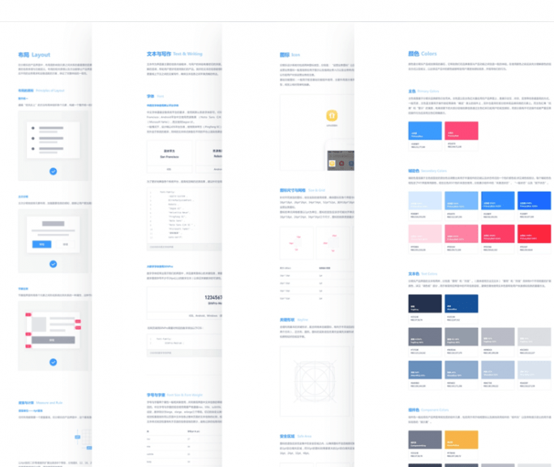

Actualmente, muchas aplicaciones utilizan **sistemas de diseño** *(Design Systems),* que amplían el concepto tradicional de guía de estilo.

Además de establecer las normas visuales, incorporan:

- **Componentes reutilizables:** botones, formularios, menús, etc.
- **Patrones de diseño:** soluciones comunes para organizar las interfaces.
- **Reglas de interacción:** comportamiento y estados de los componentes.
- **Recursos compartidos:** estilos, variables y, en algunos casos, código reutilizable.

Algunos ejemplos conocidos son **Material Design (Google)** y **Fluent (Microsoft)**.

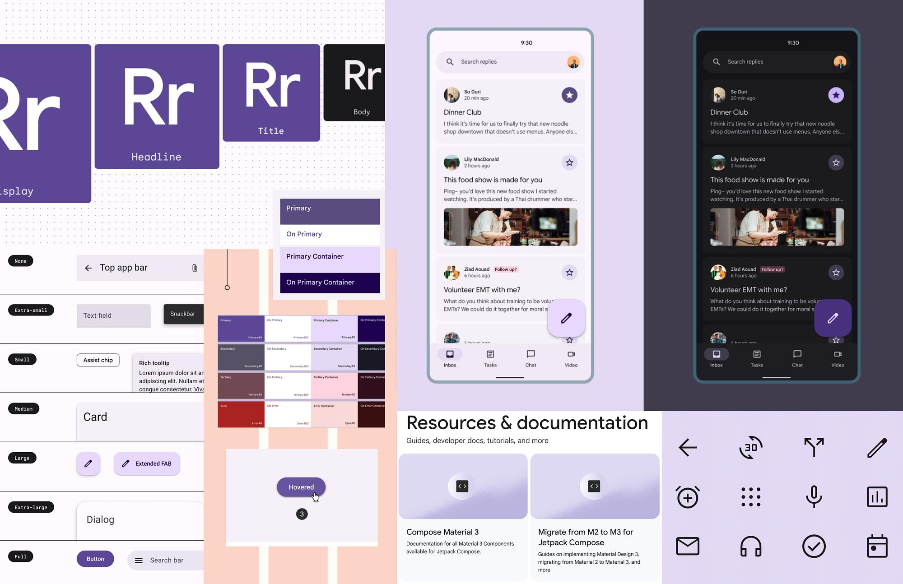

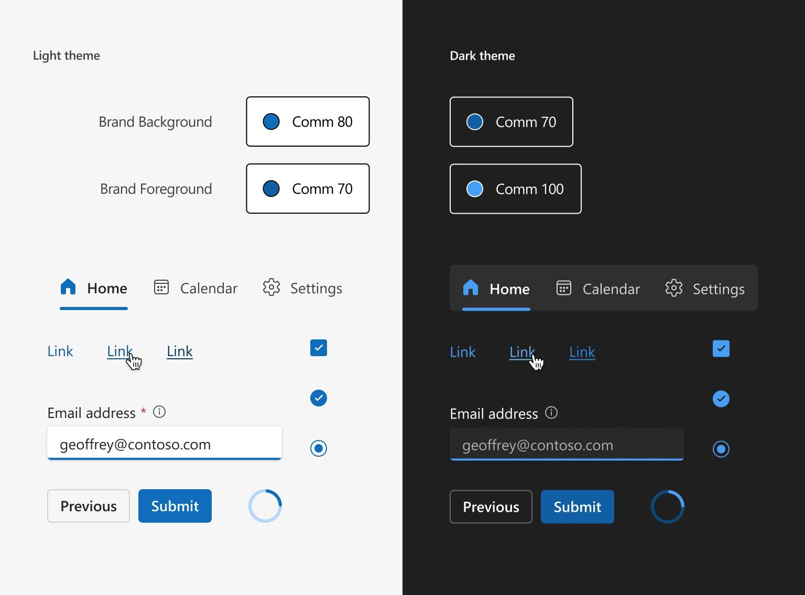

## Retícula y distribución de componentes

Una **retícula (*grid*)** es una estructura de referencia que permite organizar y distribuir los elementos de una interfaz de forma ordenada y coherente.

Generalmente, se basa en una división del espacio en **filas, columnas y áreas**, que facilitan la colocación de los componentes.

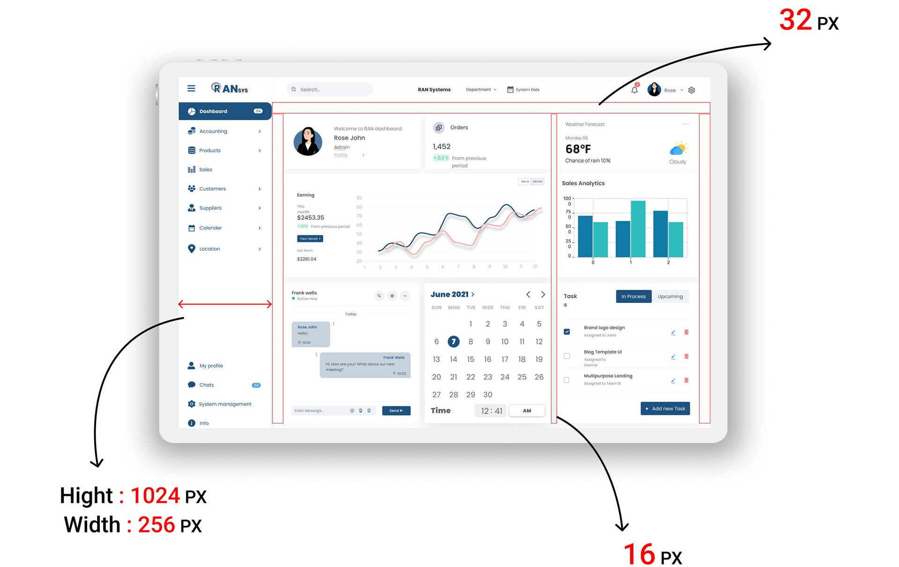

Al diseñar una interfaz, la retícula permite organizar los componentes siguiendo una estructura común. Para conseguir una distribución coherente debemos:

- **Agrupar** los componentes relacionados en una misma zona.
- **Alinear** correctamente etiquetas, campos y botones.
- Mantener **márgenes y separaciones uniformes**.
- Adaptar la distribución cuando cambia el tamaño de la ventana.

En **Java Swing**, esta organización se implementaba mediante gestores de disposición (*Layout Managers*), como BorderLayout, GridLayout o GridBagLayout. En breve veremos disposiciones web actuales como FlowLayout o GridLayout.


La retícula, puede basarse en cualquier tipo de escala como pudiera ser la orgánica, Fibonacci o irregulares.


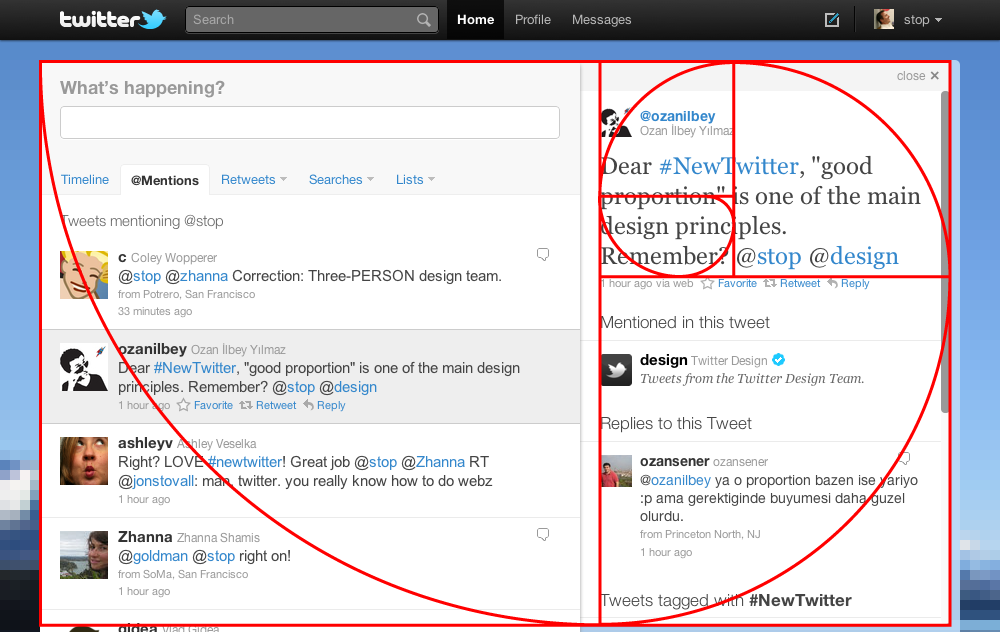

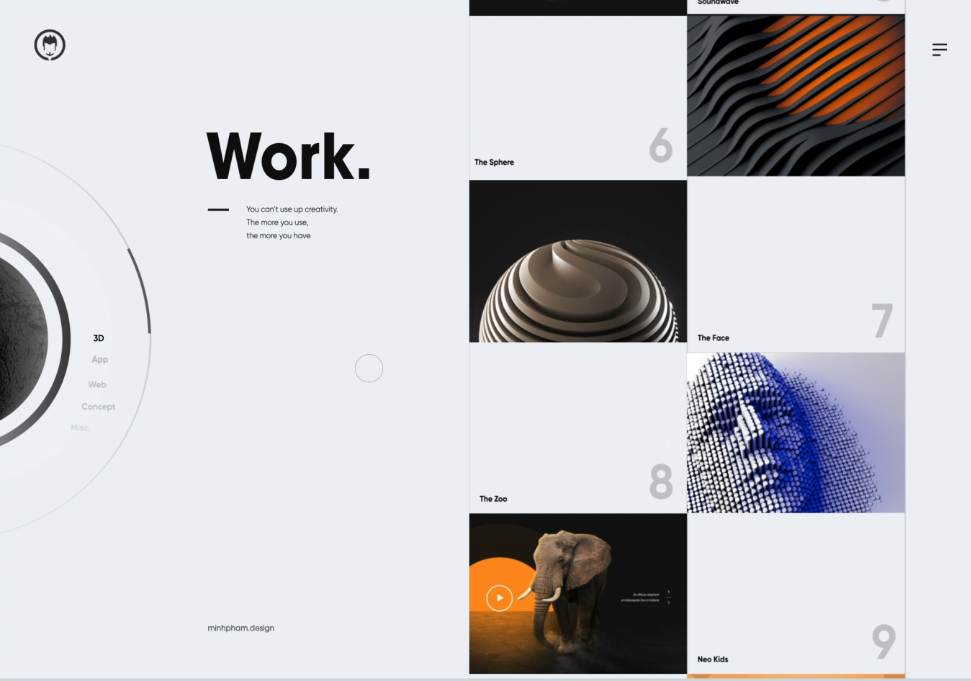

## Tipografía y legibilidad

La **tipografía** es un elemento fundamental en el diseño de interfaces, ya que permite transmitir información y organizar visualmente los contenidos.

Una elección adecuada de fuentes, tamaños y estilos permite:

- **Mejorar la legibilidad** de los textos.
- **Establecer una jerarquía visual**, diferenciando títulos, subtítulos y contenido.
- **Facilitar la identificación** de las acciones y elementos de la interfaz.
- **Mantener una apariencia coherente** en todas las pantallas de la aplicación.

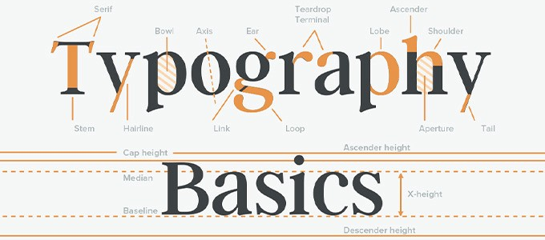

### Jerarquía tipográfica

La **jerarquía tipográfica** consiste en utilizar diferentes tamaños, grosores y estilos de texto para organizar la información según su importancia.

En una interfaz podemos distinguir:

- **Títulos principales:** identifican las pantallas o secciones.
- **Subtítulos:** permiten diferenciar apartados dentro de una pantalla.
- **Texto principal:** presenta la información habitual de la aplicación.
- **Etiquetas y textos auxiliares:** identifican campos, ofrecen instrucciones o muestran información complementaria.


### Familias tipográficas

Las fuentes tipográficas pueden clasificarse en diferentes familias según sus características visuales. Las más habituales son:

- **Serif (con remates):** presentan pequeños adornos en los extremos de las letras. Se utilizan tanto en publicaciones como en algunas interfaces digitales.
- **Sans Serif (sin remates):** tienen un diseño más sencillo y sin adornos. Son muy utilizadas en interfaces de aplicaciones y sitios web. Ejemplo: Arial, Segoe UI o Roboto.
- **Monoespaciadas:** todos sus caracteres ocupan el mismo ancho. Se emplean especialmente para mostrar código, datos técnicos o información que necesita una alineación precisa. Ejemplo: Consolas.

La elección de una fuente debe priorizar la **legibilidad y la coherencia visual** de la aplicación.

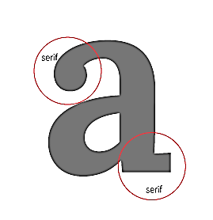 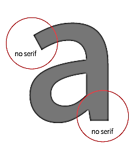


> Inicialmente, se utilizaban las fuentes típicas que los usuarios tenían instaladas en sus dispositivos y distintos SO lo que daba lugar a problemas. Actualmente, gracias a que los navegadores soportan la directiva *@font-face*, es posible utilizar casi cualquier tipo de tipografía sin necesidad de que esté instalada en el dispositivo.

### Composición tipográfica

La **composición tipográfica** consiste en organizar los textos de una interfaz para facilitar su lectura y mejorar su presentación visual.

Los principales aspectos que debemos considerar son:

- Espaciado
- Espacio entre palabras
- Longitud de línea
- Interlineado (leading)
- Alineación

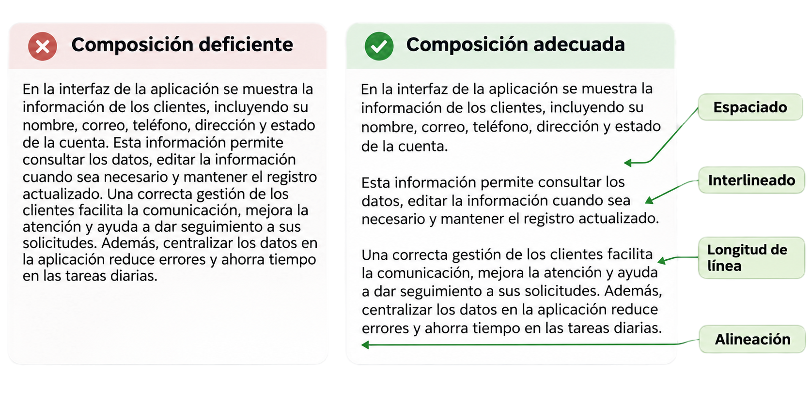

### Legibilidad

La **legibilidad** es la facilidad con la que los usuarios pueden reconocer y leer los textos de una interfaz.

Para favorecerla, debemos tener en cuenta:

- **Tipo de fuente:** utilizar tipografías claras, evitando las excesivamente decorativas.
- **Tamaño del texto:** debe ser suficientemente grande para facilitar la lectura y permitir su adaptación a las necesidades del usuario.
- **Contraste:** mantener una diferencia suficiente entre el color del texto y el fondo.
- **Estilo:** evitar el uso excesivo de mayúsculas, cursivas o negritas en textos extensos.

Relacionado con la legibilidad está el contraste. El **contraste** es la diferencia de luminosidad entre el texto y su fondo. Un contraste insuficiente dificulta la lectura.

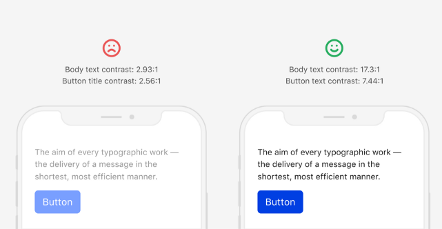

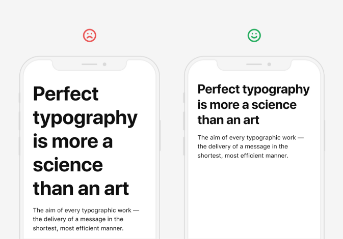

## Uso del color

El **color** es un elemento fundamental en el diseño de interfaces, ya que permite transmitir la **identidad visual** de una aplicación, establecer una **jerarquía visual** destacando los elementos importantes, **comunicar acciones y estados** (éxito, error, advertencia, etc.) y **organizar los contenidos** diferenciando secciones o agrupando elementos relacionados.

El uso del color debe ser **coherente en toda la aplicación**, evitando combinaciones excesivas o arbitrarias.

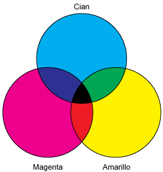

### Armonía del color

La **armonía cromática** consiste en combinar colores de manera que se consiga una apariencia visual equilibrada y coherente.

Dos o más colores armonizan si su **saturación** es la misma.

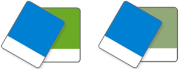

Existen matices que combinan especialmente bien: son los **colores opuestos o complementarios** (los enfrentados en el círculo cromático).

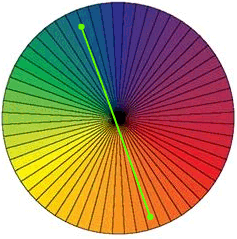

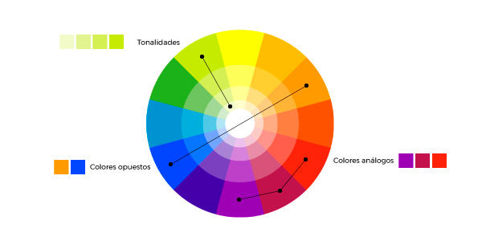

La **armonía cromática** consiste en combinar colores de manera que se consiga una apariencia visual equilibrada y coherente.

Existen diferentes formas de combinar colores:

- **Monocromática:** utiliza distintas tonalidades de un mismo color.
- **Análoga:** combina colores próximos entre sí en el círculo cromático.
- **Complementaria:** utiliza colores opuestos en el círculo cromático para generar contraste y destacar elementos.

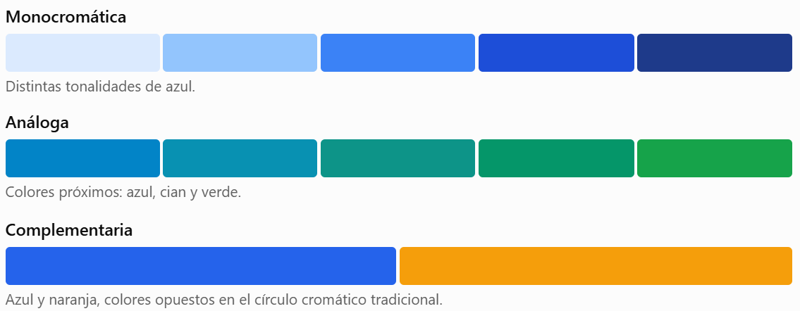

### Paleta de colores

Existen herramientas online que permiten **generar y combinar paletas de colores** para nuestras interfaces, seleccionando diferentes tonalidades y estilos (vivos, pastel, neutros, etc.).

Algunos de los generadores de paletas de color son los siguientes:

- **Color Picker**: [htmlcolorcodes.com](https://htmlcolorcodes.com/)
- **Color Wheel de Adobe**: [color.adobe.com](https://color.adobe.com/es/)
- **Color Wheel de Canva:** [canva.com/colors/color-wheel](https://www.canva.com/colors/color-wheel/)
- **Paletton**: [paletton.com](https://paletton.com/)
- **Chat de IA** 🤖: cualquiera puede ayudar a generar paletas.

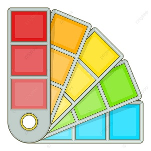

### Uso funcional de los colores

En una interfaz, los colores no solo tienen una finalidad estética, sino que también permiten **identificar elementos y comunicar información**.

Habitualmente, se asignan diferentes funciones a los colores de una aplicación:

- **Primario:** identifica la aplicación y destaca las acciones principales.
- **Secundario:** complementa al primario y permite diferenciar otros elementos.
- **Fondo y texto:** proporcionan una base visual que favorece la lectura.
- **Colores de estado:** indican situaciones como éxito, error, advertencia o información.

Estas funciones deben mantenerse **coherentes en todas las pantallas** de la aplicación.

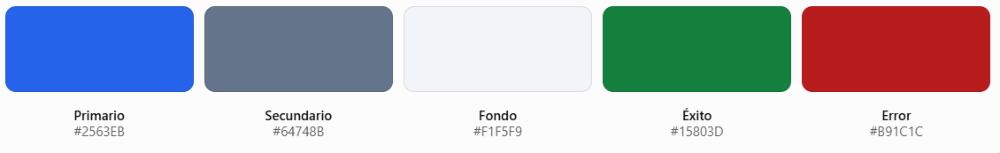

## Iconografía

Los **iconos** son elementos gráficos que representan acciones, funciones o estados de una aplicación, facilitando su identificación. Deben mantener una **apariencia visual coherente** en cuanto a formas, colores y tamaños, utilizar símbolos fácilmente reconocibles y representar siempre la misma acción de manera consistente.

Los iconos se pueden encontrar en **formatos** diferentes, que veremos a continuación:

- Mapa de bits: PNG.
- Imagen vectorizada: SVG.
- Fuentes tipográficas o emojis: las fuentes de texto pueden ofrecer iconos sencillos para la representación de elementos de la interfaz.

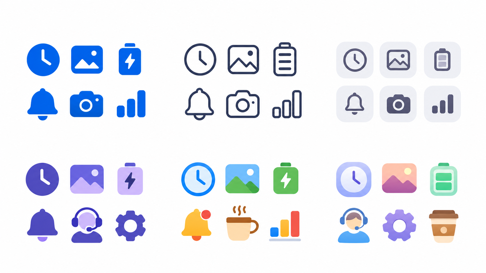

## Imágenes y formatos gráficos

El uso de **imágenes** es muy importante en el diseño de cualquier tipo de interfaz, puesto que estas contribuyen favorablemente a la experiencia del usuario, siempre y cuando se adecuen al contenido que se está trabajando.

Además de cumplir ciertos requisitos de calidad y formato, se debe tener en cuenta la autoría de las imágenes o **derechos de autor** para ciertos trabajos.

Una de las características más importantes que tener en cuenta es el **formato** de las imágenes, puesto que de esta forma se define la calidad visual frente al peso de las ilustraciones.


### Imágenes de mapa de bits

```note
Las imágenes de **mapa de bits**, también llamadas raster, están formadas por una cuadrícula de pequeños puntos denominados píxeles, cada uno de los cuales almacena información sobre su color.
```

Por esta razón, son indicadas para aquellas imágenes en las que es deseable mostrar una gama de colores muy amplia y con variaciones precisas de color y luminosidad.

La calidad de estas imágenes depende de la cantidad de píxeles utilizados en su representación (PPP). Una de las desventajas principales de las imágenes bitmap es que no permiten un **cambio de escala** significativo, puesto que aparece el llamado **pixelado**.

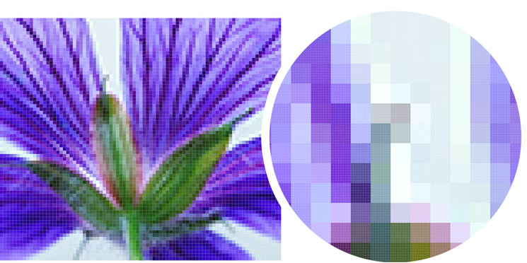

### Imágenes vectorizadas

```note
Las **imágenes vectoriales** están formadas por elementos geométricos, como líneas, curvas y figuras, definidos mediante fórmulas matemáticas. El procesador es el encargado de traducir esta información matemática a la tarjeta gráfica.
```

Las imágenes vectoriales mantendrán su forma independientemente de cuán grande o pequeño sea su tamaño. Esto significa que no se mostrarán píxeles cuando amplíe. La calidad de estos diseños seguirá siendo la misma.

No son adecuados para describir imágenes demasiado irregulares (un paisaje de fotografía real), ya que necesitaría millones de fórmulas para ello.

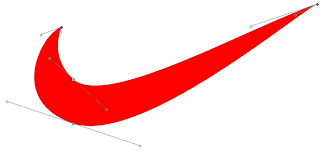

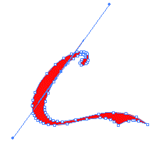

### Bitmap vs vector

**Mapa de bits** &nbsp;&nbsp; **Vector**

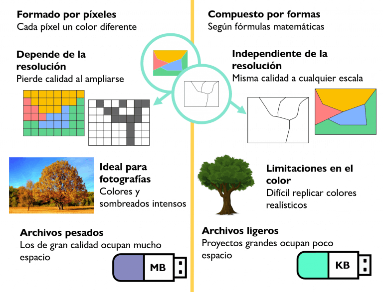

### Compresión de imágenes

Otro de los factores más importantes a la hora de escoger las imágenes que formarán parte de una aplicación, es el **tamaño** de archivo de imagen, puesto que de esto dependerá la velocidad de la transferencia.

La **compresión** de una imagen es la reducción de los datos digitales que no resultan necesarios e importantes.

Hay dos clases principales de compresión:

- **Compresión con pérdida (Lossy):** elimina parte de la información de la imagen para reducir su tamaño, pudiendo disminuir su calidad.
- **Compresión sin pérdida (Lossless):** reduce el tamaño del archivo conservando toda la información original de la imagen.

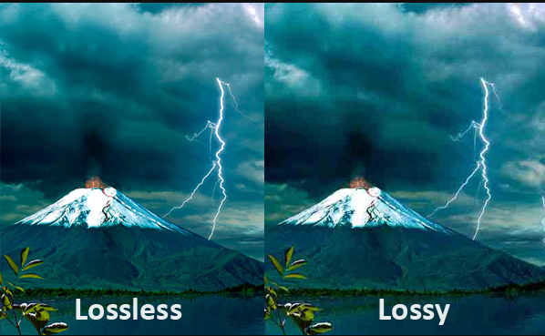

### Formatos de mapa de bits

Los formatos de mapa de bits almacenan imágenes formadas por píxeles. Se diferencian principalmente por su compresión, calidad, transparencia y compatibilidad.

| Formato | Características | Uso recomendado |
| --- | --- | --- |
| **JPEG** | Compresión con pérdida. Sin transparencia. | Fotografías. |
| **PNG** | Sin pérdida. Admite transparencia. | Capturas, iconos y gráficos. |
| **GIF** | Hasta 256 colores. Admite animaciones. | Animaciones sencillas. |
| **HEIF** | Alta eficiencia de compresión. Compatibilidad web limitada. | Fotografías de dispositivos móviles. |
| **WebP** | Con o sin pérdida. Transparencia y animación. | Imágenes web optimizadas. |

### Formatos vectoriales

Los formatos vectoriales representan imágenes mediante formas geométricas, lo que permite escalarlas sin perder nitidez.

| Formato | Características | Uso recomendado |
| --- | --- | --- |
| **SVG** | Formato abierto basado en XML. Compatible con navegadores. | Iconos, logotipos e ilustraciones web. |
| **AI** | Formato nativo de Adobe Illustrator, pensado para edición. | Diseño y creación de gráficos vectoriales. |
| **EPS** | Formato tradicional de intercambio de gráficos. | Impresión y compatibilidad con programas antiguos. |


### Elección de formato de imagen

La **elección del formato** depende del *tipo de imagen, la calidad necesaria, el tamaño del archivo y la compatibilidad* con la aplicación.

| Tipo de imagen | Formatos recomendados |
| --- | --- |
| **Fotografías** | JPEG, WebP o AVIF |
| **Capturas de pantalla y gráficos con texto** | PNG o WebP sin pérdida |
| **Iconos y logotipos** | SVG o PNG |
| **Imágenes con transparencia** | PNG, WebP, AVIF o SVG |
| **Animaciones sencillas** | GIF o WebP |

## Modelo práctico de guía de estilo

        Nombre del proyecto: [Nombre de la aplicación]

        Versión: [v1.0 / Prototipo / etc.]

        Autor(es): [Nombre del diseñador o equipo]

        Fecha: [dd/mm/aaaa]

        Objetivo:
        Establecer las normas visuales que deben aplicarse en las distintas pantallas de una aplicación para garantizar una apariencia coherente y uniforme.

        1. Paleta de colores
        2. Distribución y espaciados
        3. Tipografía
        4. Iconografía
        5. Componentes visuales

### Paleta de colores

| Nombre | Código HEX | Uso recomendado |
| --- | --- | --- |
| Primario | #1976D2 🟦 | Botones principales, encabezados, iconos activos |
| Secundario | #42A5F5 | Elementos destacados, hover, paneles secundarios |
| Fondo | #F5F5F5 ⬜ | Fondo de ventanas y paneles principales |
| Texto principal | #212121 ⬛ | Texto general |
| Texto secundario | #616161 | Etiquetas, descripciones |
| Éxito | #388E3C 🟩 | Mensajes de confirmación o estado correcto |
| Error | #D32F2F 🟥 | Mensajes de error o validación fallida |

### Distribución y espaciados

**Objetivo**

Establecer criterios de distribución, alineación y separación de los componentes para mantener una estructura visual coherente en todas las ventanas de la aplicación.

| Tipo de elemento | Alineación recomendada |
| --- | --- |
| Etiquetas (JLabel) | Alineadas con los campos correspondientes, preferentemente a la izquierda o encima de ellos. |
| Campos (JTextField, JComboBox) | Alineados entre sí y con anchuras uniformes cuando tengan funciones similares. |
| Botones (JButton) | Agrupados y alineados, manteniendo una posición y un orden coherentes. |
| Iconos o imágenes | Alineados con los componentes a los que acompañan. |

### Tipografía

**Objetivo**

Definir las fuentes, tamaños y estilos de texto que se utilizarán en la aplicación para mantener una jerarquía visual coherente y facilitar la lectura.

| **Tipo** | **Familia** | **Tamaño** | **Uso** |
| --- | --- | --- | --- |
| Título | Segoe UI Semibold | 18pt | Encabezados principales |
| Subtítulo | Segoe UI | 14pt | Etiquetas o encabezados secundarios |
| Texto base | Segoe UI | 12pt | Texto general |
| Botones | Segoe UI Bold | 12pt | Botones y acciones destacadas |

### Iconografía

**Objetivo**

Definir los iconos utilizados en la aplicación para mantener una apariencia visual coherente y facilitar la identificación de las acciones.

- Estilo: [*Plano / Material Design / Línea fina / etc*.]
- Tamaño estándar: 16x16 px para botones pequeños, 24x24px para iconos principales.
- Formato: **PNG** o **SVG** (si se usa librería compatible).

| **Elemento** | **Icono** | **Acción** |
| --- | --- | --- |
| Guardar | 💾 save.png | Guardar cambios |
| Eliminar | 🗑️ delete.png | Eliminar elemento |
| Buscar | 🔍 search.png | Buscar datos |
| Añadir | ➕ add.png | Crear nuevo elemento |
| Editar | ✏️ edit.png | Modificar elemento |

### Componentes visuales

**Objetivo**

Definir la apariencia y los estados de los componentes para mantener un diseño coherente en todas las ventanas de la aplicación.

| Componente | Criterios de estilo |
| --- | --- |
| **Botones (JButton)** | Colores según su función, tamaños uniformes y estilo coherente. |
| **Campos (JTextField, JComboBox)** | Alturas, bordes y espaciados consistentes. |
| **Etiquetas (JLabel)** | Tipografía y alineación coherentes con los campos asociados. |
| **Tablas (JTable)** | Encabezados diferenciados, filas legibles y selección visible. |

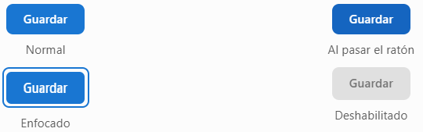

### Comprobación de una guía de estilo

| Apartado | Preguntas de comprobación |
| --- | --- |
| **Paleta de colores ✅** | ¿Están definidos los colores, sus códigos y su función? |
| **Distribución ✅** | ¿Se han establecido criterios de alineación, márgenes y espaciados? |
| **Tipografía ✅** | ¿Se han definido las fuentes, tamaños y estilos para cada tipo de texto? |
| **Iconografía ✅** | ¿Se ha seleccionado un estilo uniforme y definido el significado de los iconos? |
| **Componentes visuales ✅** | ¿Se ha establecido la apariencia y los estados de los principales controles? |

La guía debe permitir que **diferentes desarrolladores** puedan crear **nuevas pantallas** manteniendo una **apariencia coherente**.

### Ejemplos de sistemas de diseño


[https://jesusmaceira.com/7-guias-de-estilo-de-marcas-para-inspirar-tu-diseno/](https://jesusmaceira.com/7-guias-de-estilo-de-marcas-para-inspirar-tu-diseno/)

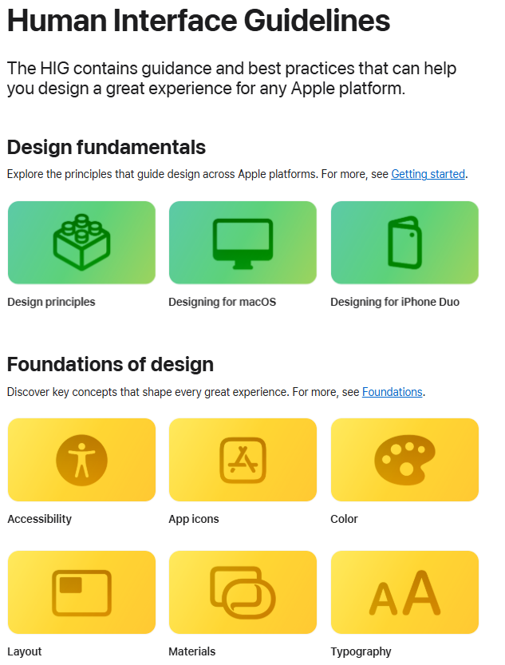

[https://developer.apple.com/design/](https://developer.apple.com/design/)

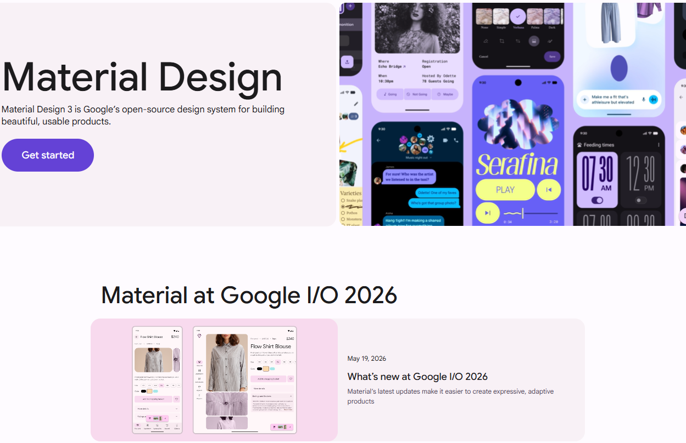

[https://m3.material.io/design](https://m3.material.io/design)

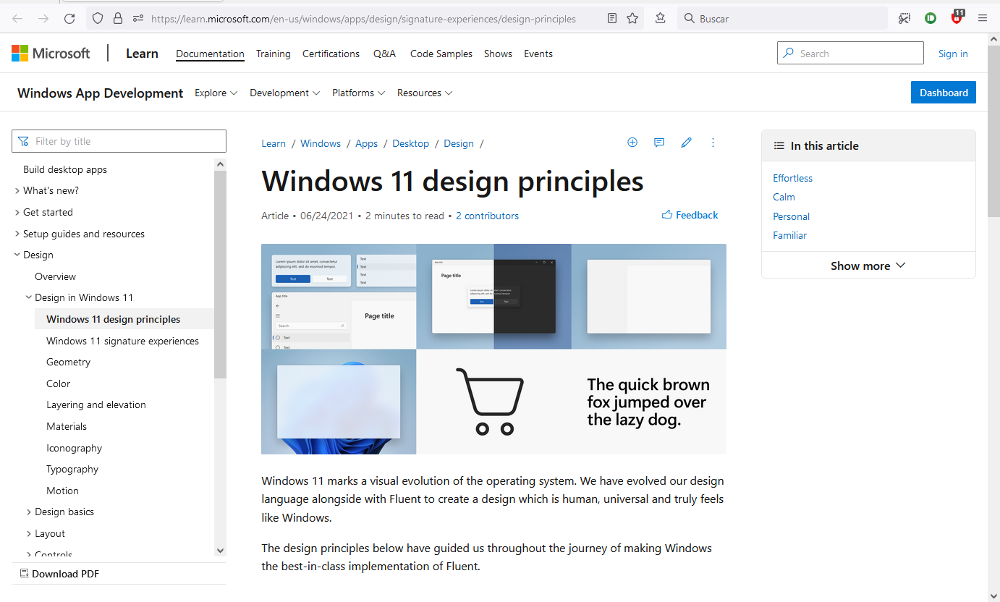

[https://fluent2.microsoft.design/](https://fluent2.microsoft.design/)
