# UT3.4: Empaquetado, distribución y despliegue de aplicaciones

## Introducción

Una vez desarrollada y probada una aplicación, es necesario prepararla para que pueda ser utilizada por los usuarios finales, sin depender del entorno de desarrollo.

Este proceso comprende diferentes fases:

- **Empaquetado:** agrupación del código compilado, las dependencias y los recursos necesarios para ejecutar la aplicación.
- **Distribución:** publicación y entrega de la aplicación a los usuarios finales.
- **Instalación:** incorporación de los archivos y configuración de la aplicación en el equipo de destino.
- **Despliegue:** conjunto de operaciones necesarias para que la aplicación esté disponible y operativa en su entorno de destino.

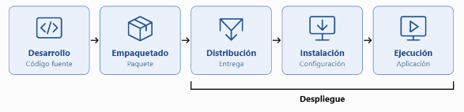

## Empaquetado de aplicaciones

El **empaquetado de una aplicación** es el proceso de agrupar todos los componentes necesarios para su ejecución en un formato organizado y distribuible.

Un paquete puede contener los siguientes elementos:

| Elemento | Descripción | Ejemplos |
| --- | --- | --- |
| Código ejecutable | Código compilado de la aplicación. | .exe, .jar |
| Bibliotecas y dependencias | Librerías externas necesarias. | .dll, .so, .jar |
| Recursos | Imágenes, iconos, sonidos y otros archivos. | resources/, img/ |
| Configuración | Parámetros de funcionamiento. | .properties, .xml, .json |
| Entorno de ejecución | Componentes necesarios para ejecutar la aplicación. | Java Runtime |
| Documentación | Manuales y licencias. | README.md, LICENSE |

### Herramientas de empaquetado

Existen diferentes herramientas de empaquetado dependiendo del lenguaje de programación, el entorno de desarrollo y la plataforma de destino.

| Entorno | Herramientas | Formatos resultantes |
| --- | --- | --- |
| Java | jar, Maven, Gradle | .jar, .war, .ear |
| Java (distribución nativa) | jpackage | .exe, .msi, .deb, .rpm, .dmg, .pkg |
| .NET | dotnet publish, Visual Studio | .exe, .dll |
| Python | setuptools, PyInstaller | .whl, .exe (Windows) |
| Linux | dpkg-deb, rpmbuild, tar | .deb, .rpm, .tar.gz |
| Android | Gradle, Android Studio | .apk, .aab |
| iOS | Xcode | .ipa |

## Despliegue y distribución de aplicaciones

El **despliegue de una aplicación** comprende el conjunto de operaciones necesarias para que el software esté disponible y pueda funcionar correctamente en el entorno.

Estas operaciones incluyen comprobar los requisitos, copiar los archivos, comprobar o instalar dependencias, así como configurar el entorno.

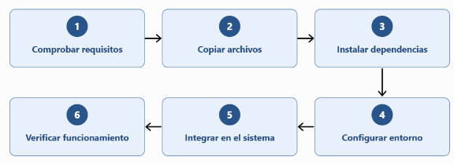

### Tipos de despliegues

Existen diferentes modalidades de despliegue según el tipo de aplicación, el entorno de destino y las necesidades de distribución.

| Modalidad | Descripción | Ejemplo |
| --- | --- | --- |
| Mediante instalador | Un asistente instala y configura la aplicación. | Inno Setup, MSI |
| Portable | La aplicación se ejecuta sin un proceso de instalación previo. | JAR, aplicación autocontenida |
| Automatizado | Se realiza mediante scripts o herramientas de automatización. | GitHub Actions, Jenkins |
| Remoto o en la nube | La aplicación se despliega en servidores remotos. | AWS, Azure |
| Contenerizado | La aplicación y sus dependencias se distribuyen mediante contenedores. | Docker, Podman |

**Aplicación portable**

El usuario recibe una carpeta con la aplicación y ejecuta directamente el programa.

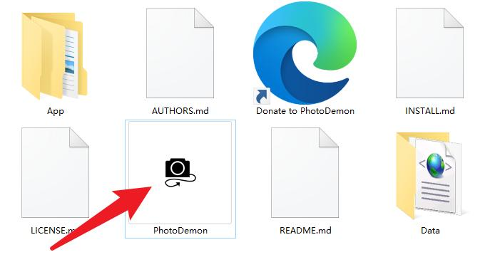

**Aplicación con instalador**

El usuario ejecuta un asistente que instala los archivos y crea los accesos directos.

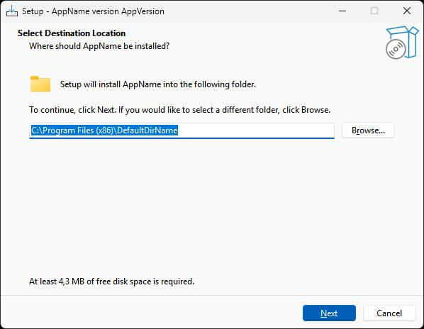

### Instaladores en sistemas Windows

Dependiendo del sistema operativo en el que nos encontramos, la forma de empaquetar las aplicaciones puede cambiar. Normalmente en el caso de Windows los más utilizados son: EXE o MSI

- **EXE**. archivo ejecutable que puede contener una aplicación o un asistente de instalación personalizado.
- **MSI** (*Microsoft Installer*): paquete de instalación gestionado mediante Windows Installer. Facilita la instalación, actualización, reparación y desinstalación de aplicaciones.
- **MSIX**: formato moderno de empaquetado de Microsoft que facilita la instalación, actualización y desinstalación de aplicaciones. Permite su distribución a través de Microsoft Store y otros canales

### Instaladores en sistemas Linux

En Linux existen diferentes **formatos de paquetes** dependiendo de la distribución:

| Formato | Distribuciones | Gestores de paquetes |
| --- | --- | --- |
| .deb | Debian, Ubuntu, Linux Mint | APT, dpkg |
| .rpm | Red Hat, Fedora | DNF, RPM |
| .rpm | openSUSE | Zypper |
| .pkg.tar.zst | Arch Linux, Manjaro | Pacman |

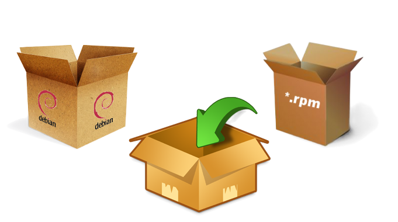

También existen **soluciones de distribución**, parecidos a los instaladores Windows:

- **Snap:** sistema de empaquetado y distribución desarrollado por Canonical.
- **Flatpak:** sistema de distribución de aplicaciones que permite ejecutarlas en entornos aislados.
- **AppImage:** formato que permite ejecutar aplicaciones sin realizar una instalación convencional.

### Instaladores en sistemas Android / iOS

En los sistemas Operativos móviles se usan los siguientes sistemas:

- Los ficheros **APK** (Android Application Package) son archivos ejecutables que contiene todos los datos que se necesitan para instalar y hacer funcionar una aplicación **Android**.
- **AAB** (Android App Bundle)Formato de publicación que permite a Google Play generar archivos APK optimizados para cada dispositivo.
- Los ficheros **IPA** (iOS AppStore Package) son paquetes que contiene una aplicación compilada para dispositivos iOS. Su instalación y distribución están sujetas a los mecanismos de firma y autorización de Apple.


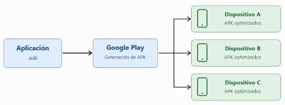

> El desarrollador puede publicar un único archivo AAB y Google Play se encarga de generar los APK necesarios para cada dispositivo, teniendo en cuenta su arquitectura, idioma o densidad de pantalla.

### Asistentes de instalación

Un **asistente de instalación** es una interfaz que guía al usuario durante el proceso de instalación de una aplicación, automatizando las operaciones necesarias para su funcionamiento.

Entre sus principales funcionalidades se encuentran:

- Comprobar los requisitos del sistema.
- Seleccionar el directorio de instalación.
- Permitir la selección de componentes opcionales.
- Solicitar la aceptación de las condiciones de licencia.
- Copiar los archivos y configurar la aplicación.
- Crear accesos directos en el sistema.
- Generar un desinstalador.

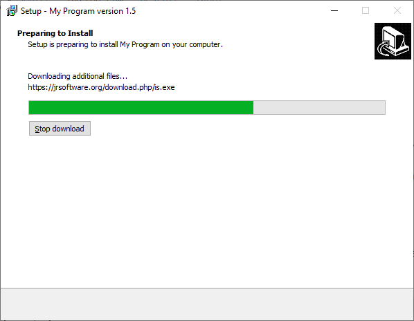

### Herramientas para creación de instaladores

| Herramienta | Plataforma | Características |
| --- | --- | --- |
| **Inno Setup** | Windows | Generación de instaladores EXE mediante scripts y asistentes. |
| **NSIS** | Windows | Creación de instaladores personalizables mediante scripts. |
| **WiX Toolset** | Windows | Creación de paquetes MSI y otros instaladores. |
| **InstallShield** | Windows | Herramienta comercial para crear instaladores. |
| **install4j** | Multiplataforma | Herramienta comercial especializada en aplicaciones Java. |
| **jpackage** | Multiplataforma | Herramienta incluida en el JDK para generar paquetes nativos de Java. |

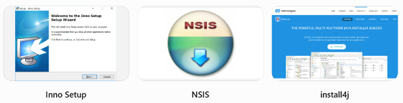

### Firma de aplicaciones

La **firma de aplicaciones** se refiere al proceso de agregar una firma digital a un archivo de software, como una aplicación o un programa, para verificar su autenticidad e integridad durante el proceso de despliegue.

La firma de aplicaciones cumple varios propósitos importantes:

- **Autenticidad:** identificar al desarrollador u organización que ha firmado la aplicación.
- **Integridad:** comprobar que el software no ha sido modificado después de firmarse.
- **Confianza:** facilitar que los usuarios y sistemas operativos puedan verificar la procedencia de la aplicación.

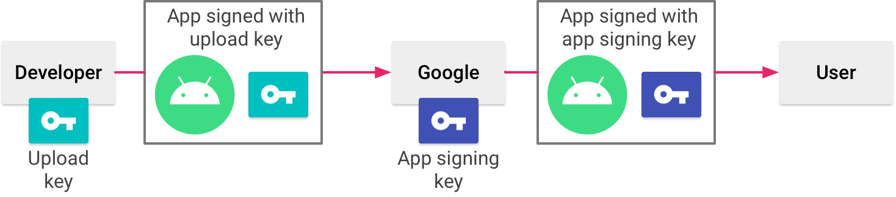

### Canales de distribución

Una vez empaquetada y preparada una aplicación, es necesario distribuirla a los usuarios finales. Los principales canales de distribución son:

| Canal | Descripción | Ejemplos |
| --- | --- | --- |
| Descarga directa | Publicación del instalador en una página web. | Web del desarrollador |
| Tiendas de aplicaciones | Plataformas que centralizan la distribución de software. | Microsoft Store, Google Play, App Store |
| Repositorios de software | Publicación de versiones y archivos descargables. | GitHub Releases, GitLab Releases |
| Gestores de paquetes | Instalación y actualización mediante herramientas de gestión de software. | WinGet, APT, Flatpak |

  

## Empaquetado de aplicaciones Java

En el desarrollo y ejecución de aplicaciones Java debemos distinguir tres conceptos:

- **JVM (Java Virtual Machine):** máquina virtual que ejecuta el bytecode de Java.
- **JRE (Java Runtime Environment):** entorno de ejecución que incluye la JVM y las bibliotecas necesarias para ejecutar aplicaciones Java.
- **JDK (Java Development Kit):** conjunto de herramientas para desarrollar, compilar, empaquetar y ejecutar aplicaciones Java.

Para desarrollar una aplicación necesitamos un JDK. Para ejecutarla, únicamente necesitamos un entorno de ejecución compatible.

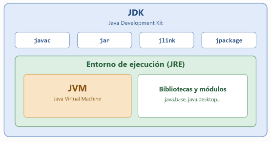

### Variables de entorno Java

Para utilizar las herramientas de Java desde la línea de comandos, podemos configurar las siguientes variables de entorno:

- **JAVA\_HOME:** indica la ubicación del JDK instalado en el equipo.
- **PATH:** contiene los directorios en los que el sistema operativo busca los programas ejecutables.

En Windows:

```bat
JAVA_HOME=C:\Program Files\Java\jdk-21
```

Añadimos a la variable PATH:

```bat
%JAVA_HOME%\bin
```

En Linux:

```bash
export JAVA_HOME=/usr/lib/jvm/jdk-21
export PATH=$JAVA_HOME/bin:$PATH
```

### Archivos JAR

Un archivo **JAR (Java Archive)** es un formato de archivo basado en ZIP que permite agrupar diferentes componentes de una aplicación Java.

Puede contener:

- Clases Java compiladas (.class).
- Recursos de la aplicación, como imágenes e iconos.
- Archivos de configuración.
- Metadatos de la aplicación.
- Bibliotecas y dependencias.

En el directorio META-INF se encuentra habitualmente el archivo MANIFEST.MF, que contiene información sobre el contenido del JAR y su configuración.

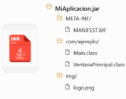

Podemos encontrar archivos JAR con diferentes características:

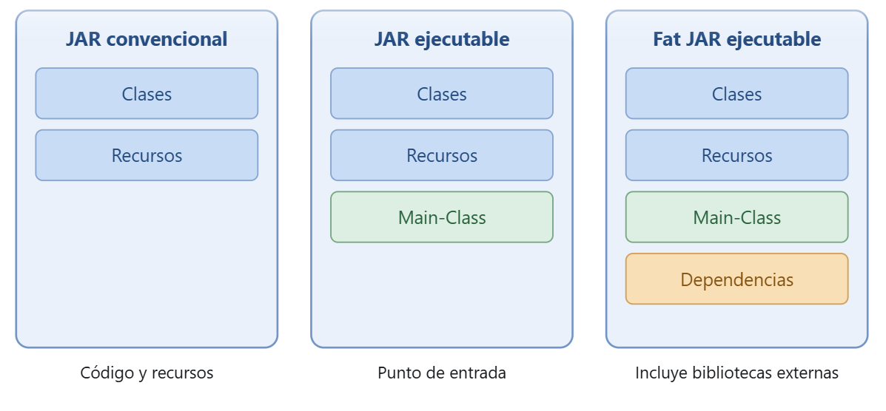

### Empaquetado en Ant

Para el empaquetado en Netbeans seleccionar en las propiedades del proyecto el apartado Build\>Packaging y dejar marcado Compress JAR File.

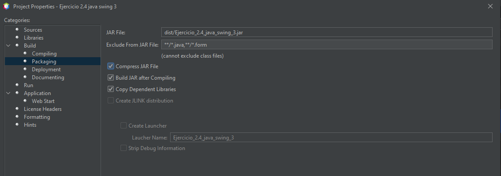

### Empaquetado en Maven

**Apache Maven** es una herramienta que permite gestionar las dependencias y automatizar el proceso de construcción de una aplicación Java mediante el pom.xml.

Para compilar, ejecutar las pruebas y empaquetar una aplicación podemos utilizar desde la línea de comandos:

```bash
mvn clean package
```

En NetBeans podemos realizar estas operaciones seleccionando **Clean and Build** sobre el proyecto.

Maven genera por defecto un archivo JAR en el directorio target cuando el proyecto utiliza el tipo de empaquetado jar.

`target/MiAplicacion-1.0-SNAPSHOT.jar`

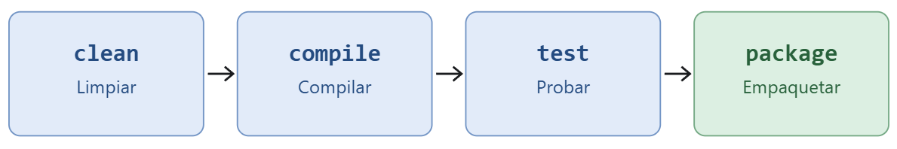

El plugin **maven-jar-plugin** permite personalizar la generación del archivo JAR.

Para que sea ejecutable mediante `java -jar`, debemos indicar la clase principal de la aplicación en el archivo *pom.xml*.

```xml
<build>
    <plugins>
        <plugin>
            <groupId>org.apache.maven.plugins</groupId>
            <artifactId>maven-jar-plugin</artifactId>
            <version>3.5.1</version>
            <configuration>
                <archive>
                    <manifest>
                        <mainClass>com.ejemplo.Main</mainClass>
                    </manifest>
                </archive>
            </configuration>
        </plugin>
    </plugins>
</build>
```

Si una aplicación Swing usa **librerías externas** (por ejemplo, *mysql-connector*, *json-simple*, etc.) el **.jar** generado por defecto **no las incluirá**.

Para que el jar contenga todas las **dependencias**, se debe usar *maven-assembly-plugin*:

```xml
<plugin>
    <groupId>org.apache.maven.plugins</groupId>
    <artifactId>maven-assembly-plugin</artifactId>
    <version>3.7.0</version>
    <configuration>
        <archive>
            <manifest>
                <mainClass>VistaControlador.GeneraNumeros</mainClass>
            </manifest>
        </archive>
        <descriptorRefs>
            <descriptorRef>jar-with-dependencies</descriptorRef>
        </descriptorRefs>
    </configuration>
    <executions>
        <execution>
            <id>make-assembly</id>
            <phase>package</phase>
            <goals>
                <goal>single</goal>
            </goals>
        </execution>
    </executions>
</plugin>
```

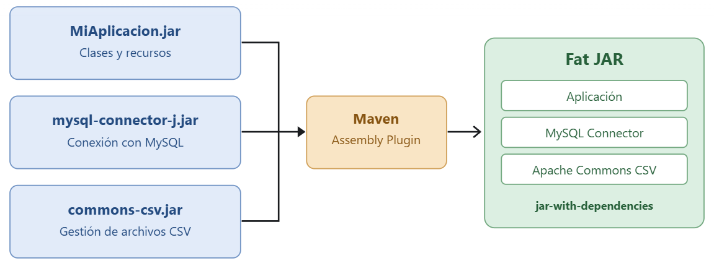

Una vez configurado el archivo *pom.xml*, ejecutaremos **Clean and Build y en** el directorio target se generarán dos archivos:

- `MiAplicacion-1.0-SNAPSHOT.jar`
- `MiAplicacion-1.0-SNAPSHOT-jar-with-dependencies.jar`

## Creación de ejecutables

### Launch4J

**Launch4j** es una herramienta gratuita y de código abierto que permite generar archivos ejecutables de Windows (.exe) a partir de aplicaciones Java.

Entre sus principales funcionalidades destacan:

- Generar ejecutables a partir de archivos JAR.
- Personalizar el icono de la aplicación.
- Localizar un entorno de ejecución Java compatible.
- Configurar parámetros de la JVM.
- Incorporar información sobre la versión del producto.
- Añadir una pantalla de inicio (splash screen).


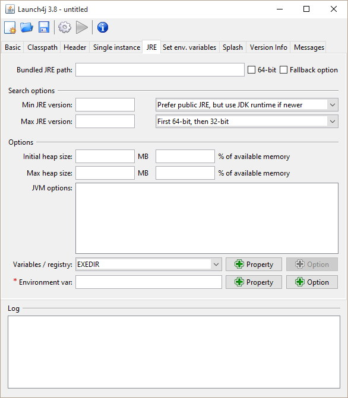

Launch4j utiliza un mecanismo denominado **wrapper** (envoltorio) que permite encapsular un archivo JAR dentro de un ejecutable de Windows.

Cuando el usuario ejecuta el archivo EXE:

1. Se localiza un entorno de ejecución Java compatible.
2. Se inicia Java con los parámetros configurados.
3. Se ejecuta la aplicación Java.

Launch4j no transforma el bytecode Java en código máquina nativo. La aplicación continúa necesitando una JVM para funcionar.

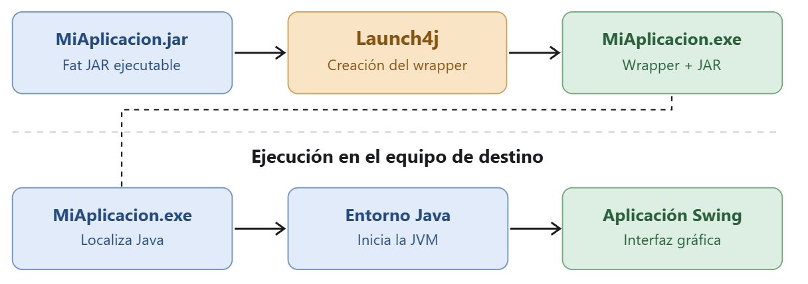

La herramienta dispone de una interfaz gráfica desde la que podremos configurar la generación del ejecutable.

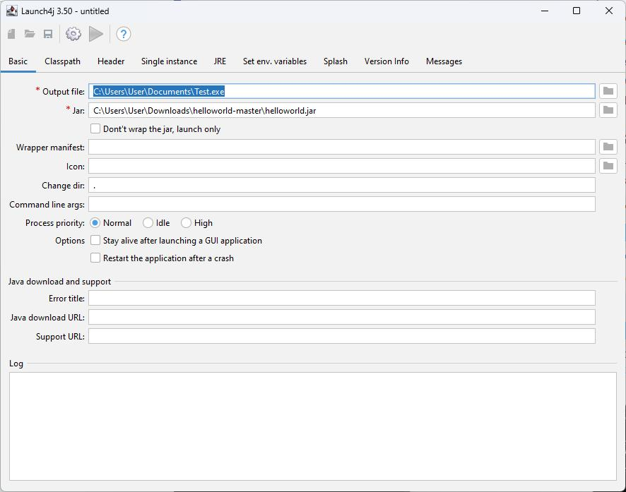


En la pestaña **Basic** configuraremos los archivos necesarios para generar el ejecutable.

| Campo | Descripción |
| --- | --- |
| **Output file** | Ruta y nombre del ejecutable que se generará. |
| **Jar** | Archivo JAR ejecutable con dependencias. |
| **Icon** | Icono de la aplicación en formato .ico. |
| **Change dir** | Directorio de trabajo de la aplicación. |
| **Don't wrap the jar** | Permite generar un lanzador sin incorporar el JAR en el EXE. |

> Dejar desmarcada la opción **Don't wrap the jar**, para que el JAR quede integrado en el ejecutable.

En la pestaña **Header** indicaremos el tipo de aplicación, en nuestro caso una **GUI**.

En la pestaña **JRE** indicaremos cómo debe localizarse el entorno de ejecución de Java en el equipo de destino.

| Campo | Descripción |
| --- | --- |
| **JRE paths** | Rutas en las que se buscará Java. |
| **Min JRE version** | Versión mínima de Java necesaria. |
| **Max JRE version** | Versión máxima admitida (opcional). |
| **Requires JDK** | Exige que exista un JDK completo. |
| **Requires 64-bit** | Exige un entorno Java de 64 bits. |
| **JVM options** | Parámetros adicionales de ejecución. |

> En nuestro caso necesitaremos un entorno compatible con Java 21.

Una vez configurados los parámetros anteriores:

1. Pulsar el botón **Build wrapper**, representado por un engranaje.
2. Guardar la configuración en un archivo XML.
3. Comprobar el resultado en el panel **Log**.
4. Localizar el archivo **EXE** generado.
5. Ejecutar la aplicación y comprobar su funcionamiento.

> El archivo XML generado y que podemos guardar, nos permite modificar la configuración y volver a generar el ejecutable cuando se publique una nueva versión.

Launch4j permite distribuir un **entorno de ejecución** Java junto al **ejecutable**, evitando que el usuario tenga que instalar Java previamente.

Para ello:

1. Obtener un entorno de ejecución Java 21 compatible con Windows.
2. Copiarlo en una carpeta denominada runtime.
3. Indicar dicha carpeta en el campo **JRE paths** de Launch4j.
4. Generar nuevamente el ejecutable.
5. Distribuir el EXE junto con toda la carpeta runtime.

> ⚠️ Launch4j no genera ni descarga automáticamente este entorno de ejecución.

### jpackage

**jpackage** es una herramienta incluida en el JDK desde Java 16 que permite generar distribuciones autocontenidas e instaladores nativos de aplicaciones Java.

Sus principales características son:

- Se utiliza desde la **línea de comandos**.
- Incluye el entorno de ejecución de Java.
- Permite ejecutar la aplicación sin instalar Java previamente.
- Genera **paquetes específicos** para cada sistema operativo (exe en Windows, deb o rpm en Linux o dmg en MacOS)

Para generar una aplicación autocontenida en Windows:

1. Generar el JAR con dependencias mediante Maven.
2. Copiarlo a una carpeta denominada input.
3. Ejecutar el siguiente comando desde una consola de **PowerShell**:

```powershell
jpackage --type app-image `
  --name MiAplicacion `
  --input input `
  --main-jar MiAplicacion.jar `
  --main-class com.ejemplo.Main `
  --icon MiAplicacion.ico `
  --dest distribucion
```

> Se generará una carpeta con el ejecutable de Windows, el JAR y el entorno de ejecución de Java.

El **resultado generado** será el siguiente:

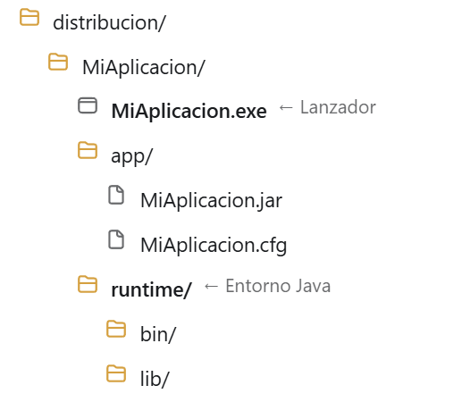

### Launch4j vs jpackage

| Característica | Launch4j | jpackage |
| --- | --- | --- |
| Interfaz gráfica | Sí | No |
| Genera ejecutables Windows | Sí | Sí |
| Incluye Java automáticamente | No | Sí |
| Permite incluir un Java propio | Sí | Sí |
| Genera instaladores | No | Sí |
| Incluido en el JDK | No | Sí |
| Plataformas de destino | Windows | Windows, Linux y macOS |

## Creación de instaladores

### Inno Setup

Inno Setup es una herramienta de código abierto que permite generar **instaladores personalizados** para aplicaciones Windows.

Sus principales funcionalidades son:

- Generar instaladores en formato EXE.
- Comprimir los archivos de la aplicación.
- Personalizar el asistente de instalación.
- Crear accesos directos.
- Ejecutar programas durante la instalación.
- Generar un desinstalador.
- Realizar instalaciones desatendidas.

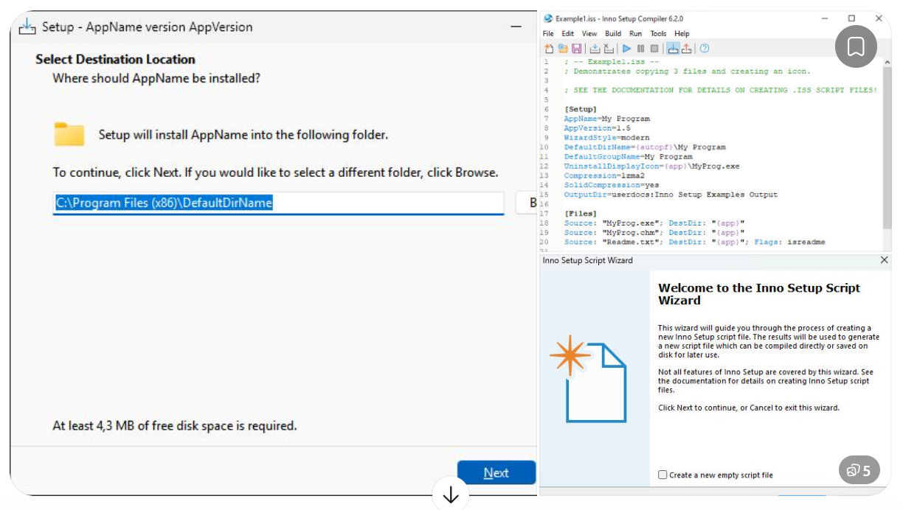

Inno Setup utiliza archivos de configuración denominados scripts de instalación, con extensión *.iss* (Inno Setup Script).

Estos archivos definen:

- Los archivos que deben instalarse.
- El directorio de instalación.
- Los accesos directos.
- La apariencia y comportamiento del asistente.
- Las operaciones de instalación y desinstalación.

El compilador de Inno Setup interpreta el script y genera un archivo EXE que contiene el instalador y los archivos necesarios de la aplicación.

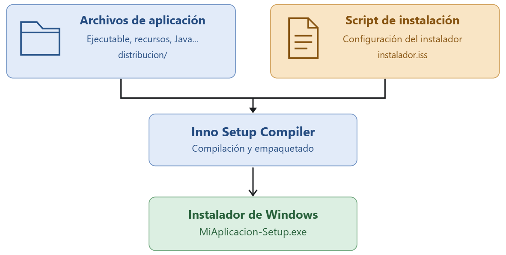

Ejemplo de configuración recomendada:

| Parámetro | Valor |
| --- | --- |
| Privilegios | Sin permisos de administrador |
| Idioma | Spanish |
| Output folder | instalador |
| Output base filename | MiAplicacion-Setup |
| Custom Setup icon | MiAplicacion.ico |
| Wizard Style | Modern |
| Contraseña del instalador | Ninguna |
